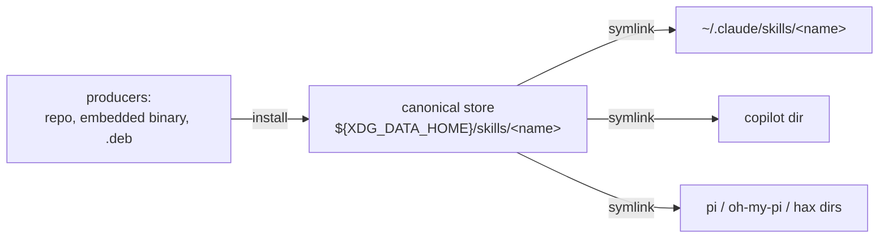

> Historical document. Superseded by [`VISION.md`](VISION.md) and [`docs/DESIGN.md`](docs/DESIGN.md); kept for context.

# NEEDED: a neutral, standard home for agent skills

## The gap

AI coding agents are converging on a common skill *format* (`SKILL.md`: a
folder with YAML frontmatter `name` + `description`, body, and optional
bundled files). They have **not** converged on a common *location*. Each
agent reads only its own proprietary directory:

- Claude Code: `~/.claude/skills/<name>/`
- Copilot, pi, oh-my-pi, hax, etc.: each its own path

There is no ratified cross-agent skills directory. The closest standards:

- **AGENTS.md** — widely adopted, but it's the repo-root *instructions*
  file, not skills, and pins a filename not a directory.
- **SKILL.md** — a converging skill *format*, but says nothing about where
  the folder lives.
- **XDG Base Directory spec** — the authority on *where user data goes* on
  Linux (`${XDG_DATA_HOME:-~/.local/share}`). No skills convention has
  officially claimed a subpath, but it's the obvious neutral home.

Because there's no shared location, tools that ship skills must either
hand-copy folders or symlink into every agent's proprietary dir
individually. That workaround is the thing we keep rebuilding.

## The need

**One canonical, agent-neutral place to write a skill, from which every
agent's proprietary location is a derived symlink.**

Declare the standard ourselves (and pre-align with the obvious ratified
answer if one ever lands):

```
${XDG_DATA_HOME:-~/.local/share}/skills/<name>/SKILL.md
```

Everything an agent reads becomes a link back to that canonical copy.

## Architecture: canonical store + symlink fan-out

Invert the current model. Instead of linking *from scattered sources into
N proprietary locations* as peers, have **one source of truth** and treat
every proprietary entry as a disposable, derived symlink.



### Why this wins

- **One source of truth.** Edit or upgrade the canonical copy once; every
  agent sees it, because its entry is just a link back.
- **Producers get a stable target.** A tool that bundles a skill — whether
  it embeds `SKILL.md` in its binary and writes it out, or ships a `.deb`
  that stages to `/usr/share/<tool>/skill` — writes to the *canonical
  store*. It never needs to know about Claude vs Copilot vs pi.
- **Proprietary knowledge is isolated** in one place (the fan-out /
  mapper), not smeared across every producer.
- **Graceful path to a real standard.** The day an agent reads
  `$XDG_DATA_HOME/skills` directly, just stop fanning out to that agent —
  the canonical copy is already in the right place.

## Pieces to build

1. **Canonical store** at `${XDG_DATA_HOME:-~/.local/share}/skills/`.
2. **Fan-out engine** — symlink each canonical skill into each known
   agent's proprietary dir; idempotent; `unlink`/`status`; only ever
   touches links it owns (provenance), never a user's own files.
3. **Producer-side install** — how a tool gets its bundled skill *into*
   the canonical store:
   - embed `SKILL.md` in the Go binary (`//go:embed`) + a `skill install`
     flag that writes it to the canonical store (copy; self-contained;
     cross-platform), or
   - a `.deb` that stages the skill at `/usr/share/<tool>/skill` and a
     per-user command that symlinks it into the canonical store (so
     `apt upgrade` refreshes it in place — Linux-only).
4. **Agent registry** — the set of proprietary locations to fan out to,
   and their order (Claude Code first).

## Open decisions

- **New tool vs fold into skills-mapper.** skills-mapper already owns
  `skills.toml` and proprietary-location knowledge; this may be "add a
  canonical XDG store as the source, make proprietary dirs symlink
  outputs" rather than a brand-new CLI.
- `XDG_DATA_HOME` (`~/.local/share`, data) vs `XDG_CONFIG_HOME`
  (`~/.config`, config) — skills are content/data, so `DATA_HOME` is the
  call, but worth confirming.
- Symlink vs copy in the fan-out (symlink keeps one source of truth;
  copy survives deletion of the store). Symlink preferred.
- Windows story (symlinks are awkward) — copy-mode fallback.

## Non-goals

- A skills registry / marketplace.
- Editing agent config files — this manages the skills *directory* only.
- Dependency resolution between skills.
