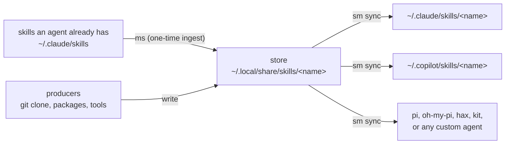

<p align="center">
  
</p>

# skills-mapper (`sm` and `ms`)

AI coding agents have converged on a skill *format* (a directory with a
`SKILL.md`), but each commercial agent keeps its skills in its own proprietary
location: Anthropic's Claude Code reads `~/.claude/skills`, GitHub Copilot
reads `~/.copilot/skills`, and so on. A skill written for one has to be copied
by hand into every other agent's folder. skills-mapper keeps one agent-neutral
**store** of skills and mirrors it into every agent's folder: `sm` fans the
store out to the agents, and `ms` is the on-ramp that copies the skills you
already have into the store.

> **Tested on Linux only.** macOS builds but has not been tested; Windows is
> unsupported. See [Limitations](#limitations).



Background: [`VISION.md`](VISION.md) (why), [`docs/DESIGN.md`](docs/DESIGN.md)
(how), [`SKILLS-DIRECTORY-SPEC.md`](SKILLS-DIRECTORY-SPEC.md) (the store
contract).

## Why this exists, and what we propose

Skills are worth reusing across agents, yet nothing says where they should live
on disk. `AGENTS.md` standardizes repository-level instructions for coding
agents, but there is no equivalent specification for the user-global skills
directory: every vendor chose its own path, so a skill you wrote or installed
for one agent is invisible to the others.

Two proposals in this repository address that, and `sm` and `ms` bridge the gap
until agents adopt them:

1. **A standard place for skills.** The
   [Skills Directory Specification](SKILLS-DIRECTORY-SPEC.md) proposes one
   agent-neutral store, `$XDG_DATA_HOME/skills/` (by default
   `~/.local/share/skills/`), with one directory per skill. An agent that reads
   the store directly needs no mapping.
2. **Tools that carry their own skill.** The
   [Skill Self-Installation Specification](SKILL-INSTALL-SPEC.md) proposes that a
   command-line tool, especially one written in Go, embeds its own skill in the
   executable (with `//go:embed`) and exposes two fixed subcommands.
   `<tool> print-skill` writes the skill to standard output, so an agent can
   learn about a tool it has never seen, dynamically, with nothing installed.
   `<tool> install-skill` writes the skill into the store, and `sm sync` then
   maps it into the default skills folder of whichever coding agents the user
   prefers. Whoever has the binary gets the documentation for it, and the
   skill and the tool ship as one artifact.

Until agents read the standard place themselves, a mapping step is needed in
both directions: `ms` maps skills *from* an agent's proprietary folder *into*
the store, and `sm` maps the store *out to* each agent's folder. Both
specifications are proposals (drafts), not adopted standards.

## Contents

- [Why this exists, and what we propose](#why-this-exists-and-what-we-propose)
- [Quick start](#quick-start)
- [Day to day](#day-to-day)
- [Concepts](#concepts)
- [Getting skills into the store](#getting-skills-into-the-store)
- [Configuring agents](#configuring-agents)
- [Command reference](#command-reference)
- [Advanced: `--store`, `--agent-home`, `--copy`](#advanced---store---agent-home---copy)
- [Safety and trust model](#safety-and-trust-model)
- [Limitations](#limitations)
- [Troubleshooting](#troubleshooting)
- [Uninstall](#uninstall)
- [Files and locations](#files-and-locations)
- [Development](#development)

## Quick start

Requirements: Linux (the only tested platform; macOS builds but is untested), Go 1.26.2 or
later, `git`, `make`, and `~/.local/bin` on your `PATH`.

The repository is <https://github.com/gherlein/sm>

```sh
# 0. Get the source (run everything below from the checkout).
git clone https://github.com/gherlein/sm.git
cd sm

# 1. Build and install both binaries.
make build                 # ./bin/sm and ./bin/ms
make install               # ~/.local/bin/sm and ~/.local/bin/ms

# 2. Put skills into the store. Either adopt the skills Claude Code already has:
ms ~/.claude/skills
#    ...or clone a skills repository laid out as one directory per skill:
#    git clone <your-skills-repo-url> ~/.local/share/skills

# 3. Only if you used ms in step 2: move the originals out of the agent folder
#    (see "After ingesting" below for why).
mv ~/.claude/skills ~/claude-skills-backup

# 4. Tell sm which agents you use. It asks y/N for each one it detects.
sm probe

# 5. Preview, apply, check.
sm sync --dry-run
sm sync
sm status
```

What a run looks like with two personal Claude Code skills and Copilot
installed (paths shortened to `~`):

```
$ ms ~/.claude/skills
ms: +2 (skipped 0)
$ mv ~/.claude/skills ~/claude-skills-backup
$ sm probe
add claude-code (~/.claude/skills)? [y/N] y
add copilot (~/.copilot/skills)? [y/N] y
added to ~/.config/skills-mapper/agents.toml: claude-code, copilot
$ sm sync --dry-run
sync: claude-code +2 -0   copilot +2 -0
$ sm sync
sync: claude-code +2 -0   copilot +2 -0
$ sm status
store: 2 skills (~/.local/share/skills)
claude-code    owned=2 missing=0 unmanaged=0 dangling=0  ~/.claude/skills
copilot        owned=2 missing=0 unmanaged=0 dangling=0  ~/.copilot/skills
```

`~/.claude/skills/<name>` and `~/.copilot/skills/<name>` are now symlinks into
`~/.local/share/skills/<name>`. From here on, change skills in the store and run
`sm sync`.

`sm probe` writes the directories into `agents.toml` as absolute paths (for
example `claude-code = "/home/you/.claude/skills"`), and `sm status` prints
absolute paths; the examples in this README show them shortened to `~`. `sm
probe` asks about every agent it detects, including ones found only because
their command is on your `PATH`; answer `n` to skip one.

## Day to day

Once set up, these are the whole routine. Every one ends with `sm sync`, which
is safe to run any time (use `sm sync --dry-run` to preview).

| You want to | Do this |
| --- | --- |
| Add or edit a skill | Create or edit `~/.local/share/skills/<name>/SKILL.md` (the directory name must equal the `name` in the frontmatter), then `sm sync`. A new skill needs the sync to appear in each agent; an edit to an existing skill is seen at once in symlink mode. |
| Pull skills from a git-backed store | `git -C ~/.local/share/skills pull`, then `sm sync`. Skills deleted upstream are unlinked by the sync. |
| Remove a skill | Delete its directory from the store, then `sm sync`. |
| Start using another agent | `sm probe` (or add a line to `agents.toml`), then `sm sync`. |
| Stop using an agent | Remove its line from `agents.toml`, then `sm clean --orphans` to remove the links `sm` left there. |
| Check that all is well | `sm status`: every agent should show `missing=0 unmanaged=0 dangling=0`. Warnings about store entries are printed after the `store:` line. |
| Adopt skills an agent made itself | `ms <agent skills folder>`, then `sm sync` (see [Getting skills into the store](#getting-skills-into-the-store)). |
| Undo everything | `sm clean`, then see [Uninstall](#uninstall). |

When something looks off, start with `sm status`, then
[Troubleshooting](#troubleshooting).

### After ingesting

`ms` copies; it never moves or deletes your originals. If you skip step 3, the
originals stay real directories in `~/.claude/skills`, `sm` refuses to replace
them, and every sync warns about each one:

```
warning: claude-code: ~/.claude/skills/emoji exists and is not managed by sm; skipping
sync: claude-code +0 -0   copilot +2 -0
```

Moving the folder aside (step 3) fixes that; `sm sync` recreates
`~/.claude/skills` with links. Before you move it, read the `ms` warnings: a
skill `ms` skipped (invalid frontmatter, a symlinked skill without
`--follow-symlinks`, a `SKILL.md` that is a symlink leaving the skill) is not
in the store and will then exist only in the backup. Keep the backup outside
`~/.claude` so a later `ms ~/.claude` does not ingest it again.

### Ingesting all of `~/.claude` also pulls plugin skills

`ms ~/.claude/skills` takes only your personal skills. `ms ~/.claude` walks the
whole tree, including `~/.claude/plugins`, so it also copies the skills that
Claude Code plugins installed. `sm sync` then links those into
`~/.claude/skills` as well, and Claude Code sees each of them twice (once from
the plugin, once as a personal skill). Ingest the whole tree only when you want
plugin skills in your other agents, and review them first: `ms` prints a
`note:` line whenever it wrote plugin skills (see
[Safety and trust model](#safety-and-trust-model)).

## Concepts

- **Skill**: a directory containing a `SKILL.md` that starts with YAML
  frontmatter declaring a `name` (and usually a `description`), followed by
  markdown instructions for the agent. Any files beside `SKILL.md` belong to
  the skill.
- **Store**: one flat directory of skills, `$XDG_DATA_HOME/skills`
  (`~/.local/share/skills` by default). Each entry's directory name must match
  `^[a-z0-9]([a-z0-9-]*[a-z0-9])?$` and equal the frontmatter `name`. Entries
  starting with `.` (such as `.git`) are ignored, so a git checkout works as a
  store. Anything else that does not conform is warned about and not
  mirrored. The full contract is [`SKILLS-DIRECTORY-SPEC.md`](SKILLS-DIRECTORY-SPEC.md).
- **Agent**: a name plus the skills directory that agent reads, listed in
  `~/.config/skills-mapper/agents.toml`. `sm` only writes into directories
  listed there.
- **Symlink mode (default)**: each store skill appears in each agent directory
  as a symlink to the store copy. Live: an edit in the store is seen at once,
  and an edit made through the agent path edits the store.
- **Copy mode (`--copy`)**: each store skill is copied as a real directory,
  marked with a hidden `.sm-copy` file. A snapshot, refreshed on every
  `sm sync --copy`, so a local edit made inside a copy is discarded by the next
  `--copy` sync (edit the store instead). Needed when the agent runs where the
  store path does not exist, such as a container that mounts only a home
  folder.
- **State**: `sm` records every link and copy it creates in a private state
  file and only ever removes entries it recorded and can still identify as its
  own.

`sm` and `ms` move skills in opposite directions:

| Tool | Direction | Use it when |
| --- | --- | --- |
| `ms` | agent folder to store, one-off copy | You already have skills inside one agent and want them in the store. |
| `sm` | store to agent folders, kept in sync | Always: after any change to the store, or to the agent list. |

`sm` never fetches or creates skills, and `ms` never touches agent folders.

## Getting skills into the store

The store is filled by whoever produces skills. `sm` only reads it.

- **A git repository** laid out as one directory per skill can be cloned
  straight into the store, and updated with
  `git -C ~/.local/share/skills pull` followed by `sm sync`.
- **A tool or package** can write its own skill into the store; the companion
  [`SKILL-INSTALL-SPEC.md`](SKILL-INSTALL-SPEC.md) describes how a command-line
  tool carries and installs its skill. Producing that install step (the
  "producer-side install", piece 3 of [`NEEDED.md`](NEEDED.md)) is **out of
  scope for this repository**: `sm` and `ms` do not implement it, and nothing
  here installs a tool's skill for you.
- **`ms`** copies skills out of an existing agent folder (today only the Claude
  Code layout).

### How `ms` works

`ms [flags] [--] <source> [dest]` copies every skill found under `<source>` into
`[dest]` (default: the store). Flags may come before or after the paths.

- **Discovery is recursive.** Every directory under `<source>` holding a
  `SKILL.md` is a skill; `ms` does not descend into a skill it found, and skips
  `.git`, `node_modules`, `vendor`, `dist` and `build`.
- **Names are normalized.** Each skill is written under the `name` from its
  frontmatter, whatever its source directory was called. A missing or invalid
  name, or frontmatter that is not valid YAML, skips that skill with a warning.
- **Duplicates are resolved by priority.** A personal skill beats a plugin
  skill (a skill is a plugin skill when its path has a `plugins` component).
  Among plugin copies, the newest `SKILL.md` wins, then path order. Every loser
  is reported and counted as skipped.
- **Existing skills are kept.** A skill already in `dest` is skipped unless
  `--force` is given; `--force` builds the new copy completely before swapping
  it in, so a failure never loses the old one.
- **Symlinked skill directories are skipped** with a warning, unless
  `--follow-symlinks` is given. That flag follows links even when they lead
  outside `<source>` (so it can pull in any directory of yours that contains a
  `SKILL.md`), refuses a link to an ancestor of `<source>`, and ingests a
  directory reached twice only once. A symlinked `<source>` itself is fine.
- **Content is filtered.** A symlink inside a skill is copied only when it is
  relative and stays inside the skill; absolute or escaping links, named pipes,
  sockets and devices are skipped with a warning. Group and world write bits
  are dropped from copied files.
- **A symlinked `SKILL.md` must stay inside the skill.** `ms` ingests a skill
  whose `SKILL.md` is a relative link to a file inside the skill (the link is
  copied as a link), but skips one whose `SKILL.md` is absolute or leaves the
  skill, including through a linked subdirectory (`SKILL.md is a symlink that
  leaves the skill; not ingested`), and one it cannot resolve inside the skill
  (`SKILL.md cannot be resolved inside the skill`, for example a loop). A
  chain of links is followed at most 8 links deep. A dry run reports the same
  skips as a real run. The skill's own tree is untrusted, so `ms` will not copy
  a manifest from outside it.
- **A skill that cannot be written does not stop the others.** If one skill
  fails (for example an unreadable file inside it), `ms` reports it
  (`ms: <name>: cannot write ...`), still writes and ledgers the rest, always
  prints the summary line, then prints `ms: <n> skill(s) could not be written`
  and exits `1`.
- **The source is checked when it is copied.** Each skill directory is pinned
  when it is validated; if it is replaced by something else (for example a
  symlink) before the copy, `ms` refuses with `source changed since it was
  validated: <path>`.
- **Overlap is refused.** `ms` will not write into the tree it is reading
  (`dest` equal to, inside, or containing `source`), with or without `--force`
  or `--dry-run`. A single skill whose target would overlap its own source (for
  example a followed link whose real path is the destination skill) is skipped
  with a warning rather than stopping the run.
- **One run at a time.** A real run (not `--dry-run`) takes `sm`'s state lock
  and then its own ledger lock, so it cannot run while `sm sync` or `sm clean`
  does (see [Safety and trust model](#safety-and-trust-model)).
- **A crash can leave `.sm-stage-*` directories in the store.** `ms` does not
  sweep them; they start with `.`, so `sm` ignores them. Delete them by hand.
- **Provenance is logged.** Every skill written is appended to a private
  ingest ledger (`~/.local/share/skills-mapper/ingest-log.json`), never inside
  the store.
- **Paths:** `~` is expanded; `$VAR` is not (your shell already expands it).
  An empty source or destination is a usage error (exit `2`), so an unset
  shell variable cannot silently turn into the current directory.

Run `sm sync` afterwards to fan the new skills out.

## Configuring agents

`sm` writes only into the agents listed in `~/.config/skills-mapper/agents.toml`
(`$XDG_CONFIG_HOME/skills-mapper/agents.toml`). Create it with `sm probe` or
`sm init`, or write it by hand.

### `sm probe`

Detects installed agents from the known-agents table below and offers to add
each one that is not listed yet. It only ever adds entries; it never removes an
entry, and never touches the store or any agent directory. The directories it
writes are absolute paths.

```
$ sm probe --dry-run
would add claude-code (~/.claude/skills)
would add copilot (~/.copilot/skills)
dry run: 2 agent(s) would be added; nothing written
$ sm probe --yes
added to ~/.config/skills-mapper/agents.toml: claude-code, copilot
$ sm probe
no new agents added
```

With nothing to add, `--dry-run` prints `dry run: no new agents to add`.
`sm probe` creates the file if it is missing, rewrites it atomically, and
refuses a file that is invalid (see the rules below) or that declares `agents`
as an inline table (`agents = { ... }`); edit such a file by hand.

### `sm init`

Writes a starter file with every known agent commented out. It never
overwrites an existing file.

```
$ sm init
wrote starter config to ~/.config/skills-mapper/agents.toml
$ cat ~/.config/skills-mapper/agents.toml
# Uncomment the agents to mirror skills into.
[agents]
# claude-code = "~/.claude/skills"
# copilot = "~/.copilot/skills"
# hax = "~/.config/hax/skills"
# pi = "~/.pi-go/skills"
# oh-my-pi = "~/.config/agents/skills"
# kit = "~/.config/kit/skills"
```

With nothing uncommented, `sm sync` prints `no agents enabled in agents.toml`.

### `agents.toml` format

One table mapping an agent name to its skills directory:

```toml
[agents]
claude-code = "~/.claude/skills"
copilot     = "~/.copilot/skills"
myagent     = "$MYAGENT_HOME/skills"
```

- An agent is enabled by being listed. Delete or comment out a line to stop
  syncing into it, then run `sm clean --orphans` to remove the links `sm` left
  there (see [`status` labels](#sm-status)).
- Any name works; the value is all `sm` needs, so a **custom agent** is just
  another line.
- Values expand a leading `~` and `$VAR` / `${VAR}`. Only a `~` written in the
  value itself is expanded; a `~` that comes from a variable's value stays
  literal and is rejected as not absolute. A variable that is unset or empty is
  an error (it would otherwise turn `$X/skills` into `/skills`), and the result
  must be absolute.

The file is checked strictly, so a mistake fails loudly instead of syncing the
wrong thing:

- Only the `[agents]` table is allowed. Any other key or table (for example a
  typo such as `[agent]`) is an error naming the key.
- A directory that is `/`, your home directory, or any ancestor of your home is
  refused.
- A directory that overlaps the store (is it, inside it, or contains it) is
  refused.
- Two agents whose directories resolve to the same real directory are synced
  once, under the first name alphabetically, with a warning.

### Known agents

`sm probe` and `sm init` know these agents. The table only suggests entries;
`sm sync` uses whatever `agents.toml` lists.

| Agent | Skills directory | Detected when |
| --- | --- | --- |
| `claude-code` | `~/.claude/skills` | `~/.claude` exists or `claude` is on `PATH` |
| `copilot` | `~/.copilot/skills` | `~/.copilot` exists or `copilot` is on `PATH` |
| `hax` | `~/.config/hax/skills` | `~/.config/hax` exists or `hax` is on `PATH` |
| `pi` | `~/.pi-go/skills` | `~/.pi-go` exists or `pi` is on `PATH` |
| `oh-my-pi` | `~/.config/agents/skills` | `~/.config/agents` exists or `omp` is on `PATH` |
| `kit` | `~/.config/kit/skills` | `~/.config/kit` exists or `kit` is on `PATH` |

## Command reference

`sm [-v] <command> [flags]`. `-v` / `--verbose` may appear anywhere and prints
one line per action on stderr. Summaries go to stdout; warnings and errors go
to stderr. `sm -h`, `sm --help`, `sm help` and `sm <command> -h` print usage.
Flags accept one or two dashes.

| Command | Flag | Meaning |
| --- | --- | --- |
| `sm sync` | | Mirror every store skill into every listed agent and reconcile. |
| | `--dry-run` | Report the counts and warnings; change nothing. |
| | `--copy` | Copy mode: real directories instead of symlinks. |
| | `--store DIR` | Use `DIR` as the store. See [Advanced](#advanced---store---agent-home---copy). |
| | `--agent-home DIR` | Re-root every agent directory from `$HOME` into `DIR`. |
| | `--allow-empty` | Let an empty store remove everything `sm` recorded (refused by default). |
| `sm status` | | Read-only report per agent. Never changes anything. |
| | `--store DIR`, `--agent-home DIR` | As for `sync`, to inspect that layout. |
| `sm clean` | | Remove every link and copy `sm` recorded, for every agent. |
| | `--agent NAME` | Only that agent. |
| | `--agent-home DIR` | The agent directories re-rooted under `DIR`. |
| | `--orphans` | Only state targets no longer listed in `agents.toml`. Cannot be combined with `--agent` or `--agent-home`. |
| `sm probe` | | Detect installed agents and offer to add each to `agents.toml`. |
| | `--yes` | Add every detected agent without asking. |
| | `--dry-run` | Report what would be added; write nothing. |
| `sm init` | | Write a starter `agents.toml`. No flags. |
| `ms <source> [dest]` | | Copy the skills under `source` into `dest` (default: the store). |
| | `--format NAME` | Source layout. Only `claude-code` (the default) exists. |
| | `--force` | Replace skills that already exist in `dest`. |
| | `--dry-run` | Report what would be written; write nothing. |
| | `-v`, `--verbose` | One line per skill on stdout. |
| | `--follow-symlinks` | Also ingest skills reached through symlinks, even outside `source`. |
| | `--` | End of flags; everything after it is a path. |

Exit codes for both tools: `0` success, `1` error, `2` usage error (a bad flag,
missing arguments, `sm` with no command).

Usage errors are caught before anything is read or written, so a mistake never
widens what a command touches:

- A flag given an empty value (`--store ""`, `--agent ""`, `--agent-home ""`,
  typically an unset shell variable) is refused: `sm sync: --store must not be
  empty`. An empty `ms` source or destination is refused the same way.
- `sync`, `status`, `clean`, `probe` and `init` take no positional arguments;
  `sm clean a` and `sm sync now --dry-run` fail with `sm clean: unexpected
  argument "a"` instead of cleaning everything or syncing for real.

The summary lines in `sm -h` and `ms -h` are short: `sm -h` says `sync` will
"link every store skill into each agent directory" and `status` reports
"linked" skills, though both also cover copies (`--copy`, `owned`); `ms -h`
calls the source "a proprietary agent skills folder", meaning an agent's own
skills folder such as `~/.claude/skills`.

### `sm sync`

One term per agent. In symlink mode `+N` links were created, `-M` removed (the
store skill is gone), and `~R` (shown only when non-zero) links were repointed
because the store skill moved:

```
$ sm sync
sync: claude-code +2 -0   copilot +2 -0
$ sm -v sync --store ~/alt-skills
claude-code: relinked emoji
claude-code: unlinked code-review
claude-code: unlinked pdf-tools
copilot: relinked emoji
copilot: unlinked code-review
copilot: unlinked pdf-tools
sync: claude-code +0 -2 ~1   copilot +0 -2 ~1
```

Copy mode always shows `+N ~R -M`, where `~R` counts copies refreshed from the
store:

```
$ sm sync --copy --agent-home ~/agent-homes/worker
sync: claude-code +3 ~0 -0   copilot +3 ~0 -0
$ sm -v sync --copy --agent-home ~/agent-homes/worker
claude-code: refreshed code-review
...
sync: claude-code +0 ~3 -0   copilot +0 ~3 -0
```

`--dry-run` prints the same line with the counts a real run would produce,
except that it does not check whether the agent directory is safe to write
(see [Limitations](#limitations)): with a world-writable agent directory it
reports counts and exits `0` where a real run refuses.
Other `-v` lines: `<agent>: linked <name>`, `copied <name>`,
`removed copy <name>`, `dropped record for <name> (link already gone)`,
`swept <n> orphaned stage dir(s)`. An agent directory that does not exist yet
is created.

A copy-mode `--dry-run` does not read file contents, so it cannot predict
warnings about skipped entries inside a skill (special files, escaping links)
or read errors such as an unreadable file; those appear only in a real run.

If copying one skill fails (an unreadable file, for example), `sync --copy`
keeps going: the other skills are copied for every agent, the state is saved,
the summary is printed, and the command then prints `sm: sync failed:` followed
by one `agent <a>: <skill>: <error>` line per failure and exits `1`. Fix the
cause and run it again; it completes the rest. Errors that make the run unsafe
to continue (an unusable agent directory, a lock, a state or identity error)
still stop it at once.

A store that does not exist gives `warning: read skills store: ...; no changes
made` followed by `sm: sync failed: ...` for `sync`, and only the `sm: status
failed: ...` line for `status`; both exit `1` and change nothing. `sync` refuses
a world-writable store (`store <dir> is world-writable; refusing`, also with
`--dry-run`); a group-writable store, or a read-only store owned by someone
else, is accepted.

When you change how an agent's directory is spelled in `agents.toml`, `sync`
moves its records for you; see
[If you respell an agent directory](#if-you-respell-an-agent-directory).

### `sm status`

```
$ sm status
store: 5 skills (~/.local/share/skills)
claude-code    owned=4 missing=1 unmanaged=0 dangling=0  ~/.claude/skills
copilot        owned=4 missing=1 unmanaged=0 dangling=0  ~/.copilot/skills
orphaned target: ~/.pi-go/skills (4 entries)
```

| Column | Meaning |
| --- | --- |
| `owned` | Store skills present as `sm`'s own link or copy. |
| `missing` | Store skills not present yet; `sm sync` adds them. |
| `unmanaged` | Store skills whose name is taken by something `sm` did not create (or no longer recognizes); `sm` leaves it alone. |
| `dangling` | `sm` links that no longer resolve, or records for skills that left the store; `sm sync` removes or repoints them. |

Store warnings (non-conforming entries) are printed after the `store:` line.
Without `--agent-home`, `status` also lists directories in the state file that
`agents.toml` no longer maps:

| Line | Meaning | What `sm clean --orphans` does |
| --- | --- | --- |
| `orphaned target: <dir> (<n> entries)` | An agent removed from `agents.toml`. | Removes its `sm` entries (identity-checked) and forgets it. |
| `aliased target: <dir> (same directory as agent <name>)` | Another spelling (via a symlink) of a listed agent's directory, for example after you changed how the path is written. The next `sm sync` adopts its verified records (see [If you respell an agent directory](#if-you-respell-an-agent-directory)). | Merges the records that still verify into the listed agent (`merged <n> record(s) from <old> into <dir>`) and drops the duplicate (`<old>: same directory as agent <a>; dropped its duplicate record, removed nothing`); removes nothing on disk. |
| `provisioned target: <dir> (<n> entries; clean with: sm clean --agent-home <root>)` | A layout made with `--agent-home`, shown this way only while the layout's path still ends with a configured agent's home-relative path (for example `.claude/skills`); this works whether the agent is spelled through `$HOME` or, when `$HOME` is a symlink, through its resolved path. Once you remove the agent, or respell its directory so that no longer matches, the same directory shows as `orphaned target`. | Leaves it alone and prints `<dir>: provisioned with --agent-home; left alone (clean with: sm clean --agent-home <root>)`; run the printed command. If it shows as an orphan, `sm clean --orphans` removes its `sm` entries; to be explicit, run `sm clean --agent-home <root>` first. |
| `unclassifiable target: <dir> (<reason>)` | A record whose path cannot be resolved. | Leaves it alone. |

### `sm clean`

Removes entries only when they are still `sm`'s by identity; the store and
anything you placed by hand are untouched. Per-entry lines go to stderr, the
summary to stdout. Before cleaning an agent, `clean` first adopts records kept
under another spelling of its directory (the same step `sync` does), so
cleaning after respelling an agent directory still removes its links. With no
agent in `agents.toml` it prints `no agents enabled in agents.toml`.

```
$ sm clean --agent copilot
copilot: unlinked code-review
copilot: unlinked emoji
clean: copilot -2
$ sm clean
claude-code: unlinked code-review
claude-code: unlinked emoji
clean: claude-code -2   copilot -0
$ sm clean --agent-home ~/agent-homes/worker
claude-code: removed copy code-review
...
clean: claude-code -3   copilot -3
$ sm clean --orphans
~/.pi-go/skills: unlinked code-review
...
clean: ~/.pi-go/skills -4
$ sm clean --orphans
clean: no orphaned targets
```

Other `--orphans` lines, one per target it leaves or tidies:

```
merged 1 record(s) from ~/.claude/skills into ~/cl2/skills
~/.claude/skills: same directory as agent claude-code; dropped its duplicate record, removed nothing
~/trial/.claude/skills: provisioned with --agent-home; left alone (clean with: sm clean --agent-home ~/trial)
```

The agent directories themselves are left in place (empty).

`clean` also refuses to remove anything inside an agent directory that is
world-writable or not owned by you, and says how to proceed:

```
sm: clean failed: agent claude-code: refusing target dir /home/you/.claude/skills: world-writable (fix with: chmod o-w '/home/you/.claude/skills'); to clean the other agents meanwhile, run: sm clean --agent copilot
```

(the path is always absolute; the last clause appears only for an unscoped `clean` when other agents exist).

### `ms`

```
$ ms --dry-run -v ~/.claude/skills
would-copy code-review -> ~/.local/share/skills/code-review
would-copy emoji -> ~/.local/share/skills/emoji
ms: +2 (skipped 0)
$ ms -v ~/.claude
ms: warning: skipping symlink ~/.claude/skills/code-review (use --follow-symlinks)
ms: warning: skipping symlink ~/.claude/skills/emoji (use --follow-symlinks)
copied pdf-tools -> ~/.local/share/skills/pdf-tools (plugin)
note: 1 ingested skill(s) came from plugin directories; review third-party skills before enabling them for your agents
ms: +1 (skipped 2)
$ ms ~/claude-skills-backup
ms: warning: skipped code-review: ~/.local/share/skills/code-review exists; use --force to overwrite
ms: warning: skipped emoji: ~/.local/share/skills/emoji exists; use --force to overwrite
ms: +0 (skipped 2)
```

`+N` is the number of skills written (or that would be written); `skipped`
counts invalid skills, duplicates, collisions with existing skills, skipped
symlinks, and skills refused for a symlinked `SKILL.md`. In the second example
the symlinks are `sm`'s own links in `~/.claude/skills`, which point back into
the store, so skipping them is correct.

The `note:` about plugin skills is printed only by a real run. A `--dry-run`
prints no note; use `-v` to see which skills are plugin skills (their
`would-copy` line ends with `(plugin)`).

If any skill could not be written, the summary is still printed and `ms` ends
with `ms: <n> skill(s) could not be written` and exit status `1`.

## Advanced: `--store`, `--agent-home`, `--copy`

### `--store DIR`

Reads skills from `DIR` instead of `~/.local/share/skills`. **On its own it
rewrites your real agent directories**: every agent is reconciled against
`DIR`, so links for skills not in `DIR` are removed and the rest are repointed
(see the `-v` example above). Running a plain `sm sync` afterwards puts the
default store back. If `DIR` holds no skills and `sm` has recorded entries,
`sync` refuses (pass `--allow-empty` if that is really what you want), so a
typo or an unmounted disk does not wipe your setup. The one exemption is
narrow: the refusal is skipped for an agent only when every skill `sm` recorded
for it is a store entry that is present but currently unusable (a temporarily
broken `SKILL.md`); one unrelated directory with a matching name does not
defeat the guard.

To try another library without touching your agents, pair it with
`--agent-home`:

```sh
sm sync   --store ~/alt-skills --agent-home ~/trial-home
sm status --store ~/alt-skills --agent-home ~/trial-home
sm clean  --agent-home ~/trial-home
```

### `--agent-home DIR`

Rebases every agent directory from your home into `DIR`: `~/.claude/skills`
becomes `DIR/.claude/skills`, and so on. The result is laid out like a real
home, so a process started with `HOME=DIR` finds its skills where it expects
them. Each such layout is tracked separately in the state file; `sm clean
--agent-home DIR` removes only it, and a plain `sm status` lists it as a
`provisioned target` while its agent is still configured in `agents.toml`; once
the agent is removed, or its directory is respelled so it no longer ends with
the same home-relative path, the same directory shows as an `orphaned target`,
and `sm clean --orphans` removes its `sm` entries (run
`sm clean --agent-home DIR` first to be explicit). An agent whose directory is
outside your home cannot be re-rooted and is an error
(`skills dir "<dir>" is not under home "<home> or <home>"; --agent-home cannot
re-root it`; the home is printed once for each spelling `sm` tried, which is
the same path twice when `$HOME` is not a symlink).

`--agent-home` re-roots the agent path exactly as `agents.toml` spells it, so
keep the conventional spelling (`~/.claude/skills`, not a resolved symlink
path); if the spelling does not start with your home, or you change it later,
`HOME=DIR` will not find the skills and the earlier layouts become orphaned
targets.

### `--copy`

Writes real directories instead of symlinks, for an agent that runs where the
store path does not exist (typically a container that mounts only a profile
folder):

```sh
sm sync --copy --store ~/my-skillset --agent-home ~/agent-homes/worker
# -> ~/agent-homes/worker/.claude/skills/<name>/  (real directories)
```

- Copies are snapshots, refreshed on every `sm sync --copy`. Run it again after
  the store changes. A refresh replaces the whole directory, so any local edit
  made inside a copy is discarded.
- Each copy carries a `.sm-copy` marker naming its store path; `sm` refreshes
  or removes only a directory whose marker matches its record.
- Manage one directory in one mode. A `--copy` sync into a directory that holds
  `sm` symlinks (or the reverse) skips each entry with
  `managed by sm in <mode> mode; run 'sm clean' to switch`.
- Skills meant for copy mode should be self-contained: symlinks that are
  absolute or leave the skill are skipped with a warning.
- A store skill whose `SKILL.md` is a symlink is copied with the manifest's
  content as a regular file (so the copy is never a skill without its manifest;
  the file must be a regular file of at most 1 MiB, and unchanged since the
  store was read, otherwise `SKILL.md changed since it was validated: <path>`).
  Two limits: a chain of links to `SKILL.md` may be at most 8 links long, and
  a `SKILL.md` reached through a directory symlink that is absolute or leaves
  the skill fails with `path escapes from parent` (a relative directory link
  that stays inside the skill works). Make `SKILL.md` a regular file, or a
  relative link that stays inside the skill.
- In symlink mode an absolute symlink inside a store skill is not touched: the
  agent sees the skill through the link to the store and follows it wherever it
  points.

For a worked example of copy mode feeding a containerized agent, see agentdev's
[applying sm-managed skills](https://github.com/emergingrobotics/agentdev/blob/main/docs/applying-sm-managed-skills.md).

## Safety and trust model

**What `sm` and `ms` will and will not delete.** Removal is identity-based. A
symlink is removed only when its target is exactly the string `sm` recorded; a
copy only when its `.sm-copy` marker is a regular file naming the recorded
store path, and both the copy directory and its marker are owned by you.
Being a symlink, or having a marker, is never enough. Anything else at a name
`sm` wants (your hand-placed skill, a link you re-pointed) is left alone and
reported (`exists and is not managed by sm`, `is no longer an sm link`). `ms`
never deletes outside the one entry it replaces under `--force`, and never
follows a symlinked entry into what it points at.

**What is verified before writing.**

- Copies (`sm sync --copy`, `ms`) are built in a randomly named `.sm-stage-*`
  directory inside the target, written only through a handle confined to that
  stage, and renamed into place after checking the stage is still the directory
  that was created. A replacement is a swap: the old version is moved aside
  (`.sm-old-*`), the new one moved in, then the old one deleted; on failure the
  old one is restored.
- Deletion goes through handles, not paths. A staged or set-aside directory is
  opened, checked to be the directory that was created, and emptied through that
  handle, so a path swapped in afterwards is never recursed into. A member of a
  group that can write the agent directory therefore cannot make `sm` delete one
  of your other directories by renaming it to a `.sm-stage-*` or `.sm-old-*`
  name.
- Each source skill is pinned when it is validated (its directory identity, and
  for a symlinked `SKILL.md` the manifest's identity, size and modification
  time). If the directory is swapped for something else (a symlink to a private
  directory, say) before the copy, the copy is refused:
  `source changed since it was validated: <path>` or `SKILL.md changed since it
  was validated: <path>`. A store skill that resolves to the agent directory, or
  to a parent of it, is refused (`refusing to copy <src> to <dst>: the
  destination overlaps the source`) instead of recursing.
- The directory being written into or removed from (an agent directory, or the
  `ms` destination) must be owned by you and not world-writable (group-writable
  is fine, for example a home directory created with umask `002`, which gives it
  mode `0775`); otherwise the run
  refuses with a hint (`world-writable (fix with: chmod o-w '<dir>')`, `not
  owned by the current user`). In symlink mode the check runs before links are
  added, repointed or removed; a sync that has nothing to create, repoint or
  remove does not check the directory. The store must not be world-writable
  (`sync` refuses it); group-writable and foreign-owned read-only stores are
  accepted.
- `SKILL.md` must be a regular file of at most 1 MiB; named pipes, sockets and
  devices are never copied.
- Overlaps are refused: an agent directory overlapping the store, an `ms`
  destination overlapping its source, and a skill overlapping its destination.
- One run at a time: `sm sync`, `sm clean` and `ms` all take the state lock
  (`state.json.lock`), and `ms` also takes its own ledger lock
  (`ingest-log.json.lock`), always in that order. A second concurrent run fails
  at once: `another sm or ms process is running (lock <path>)` for the state
  lock, `another ms process is running (lock <path>)` for the ledger lock. So
  `sync`, `clean` and `ms` serialize with one another; two `ms` runs also
  serialize on the ledger. Dry runs, `status`, `probe` and `init` do not lock.
- The state and ingest ledger are private (`0600` files in a `0700`
  directory). A state file with an unknown version, a missing or `null`
  `targets` object, a target key that is not a clean absolute path (a `..`
  segment, a doubled or trailing separator) or malformed records is refused
  rather than overwritten. unclean keys are refused, but the file is trusted: an editor of `state.json` can add any absolute directory as a target, and `clean --orphans` removes there any entry that verifies by identity (a link whose target matches the record, or a marked copy you own).
  Keep the file private.
- Terminal safety: names and paths taken from a skill tree (directory names,
  symlink targets) are printed with control characters and invalid UTF-8
  escaped as `\x1b` and the like, so a crafted name cannot rewrite or hide
  warnings such as the plugin `note:`.

**Residual limits.** These are not defended against:

- Only the target directory is checked, not its parents. A member of a group
  that can write the target directory can still race the final rename, and can
  win a race that replaces an empty directory of yours during a removal (a
  non-empty one is never removed that way). Deletion through handles closes the
  recursive-delete race; the design stops a non-owner from planting symlinks,
  deleting foreign content or losing the old skill. It is not a defense against
  a hostile process running as you.
- Marker forgery by the same owner: a `.sm-copy` marker is a plain file that
  names a store path. A process running as you can create a directory with a
  matching marker, and `sm` will treat it as its own copy. Ownership is checked
  (a marker made by another user is not trusted), but not authenticated.
- The store is not authenticated beyond the refusal of a world-writable store:
  anyone who can write your store can put instructions in front of every agent,
  and `sm` trusts what is there (see "Skill content is untrusted" below).
- Absolute symlinks inside a store skill pass through in symlink mode: the
  agent follows the link wherever it points. They are skipped only in copy mode
  and by `ms`.
- `ms --follow-symlinks` can pull in any directory you can read that contains a
  `SKILL.md`, because it follows links outside the source tree.
- The ingest ledger only grows (it is append-only and unbounded), and the state
  and ledger files are written by temp file and rename without an `fsync`, so a
  power loss at the wrong moment can lose the latest save.
- The manifest pin is the file's identity, size and modification time: an edit
  in place that keeps all three, or a recycled inode with the same size and
  time, is not detected (low risk).
- Restoring after a failed swap uses a plain rename, which can overwrite an
  entry that a second writer created at that name in the same instant.
- Overlap checks compare paths byte for byte; on a case-insensitive filesystem
  a differently cased spelling can slip past them.
- A dangling symlink used as an alias is resolved by following it (up to 40
  hops).

**Skill content is untrusted.** A skill is a set of instructions an AI agent
will follow, with the agent's permissions. `ms` can copy third-party plugin
skills into the store and `sm` then hands them to every agent you listed.
Review a skill before it reaches the store. The only provenance kept is:

- the `note: N ingested skill(s) came from plugin directories; ...` line `ms`
  prints when it wrote plugin skills, and
- the ingest ledger, which records for every skill `ms` wrote its name, source
  directory, source root, whether it came from a plugin, and when. It is
  append-only, so `--force` re-runs add records.

In symlink mode an agent reads the store copy directly, so whatever is in the
store is what the agent gets.

## Limitations

- User-global only: there is no per-project or system-wide store.
- Tested on Linux only. macOS builds but has not been tested. Windows is untested
  and unsupported: symlink mode needs extra privileges there, and the lock and
  ownership checks are no-ops.
- Symlink mode is live, copy mode is a snapshot (see [Concepts](#concepts)).
  Containers and sandboxes that do not see the store path need `--copy`.
- `ms` understands only the Claude Code layout (`--format claude-code`).
- State is keyed by each agent directory as written in `agents.toml` (symlinks
  not resolved; under `--agent-home` the home is resolved). After you change
  how an agent's path is spelled, the next `sm sync` adopts the records that
  still verify (see
  [If you respell an agent directory](#if-you-respell-an-agent-directory));
  `sm clean --orphans` tidies what is left under the old spelling.
- A regular file in the store root (as opposed to a directory) is ignored
  silently, so if one takes the name of a skill `sm` recorded, that skill's
  links are pruned by the next sync.
- A crash at one precise point of a copy can leave a `.sm-stage-*` directory
  that is not swept automatically, and `.sm-old-*` directories are never
  deleted automatically; remove either by hand. `ms` never sweeps: a leftover
  stage in the store is ignored by `sm` (it starts with `.`) but stays until
  you delete it.
- A removed agent whose directory ends with a still-configured agent's
  relative path (for example `~/work/.claude/skills` once `claude-code` is
  configured) is labelled `provisioned`, not `orphaned`, so `clean --orphans`
  leaves it; use `sm clean --agent-home <root>`.
- `--dry-run` does not check target-directory safety. With a world-writable
  (or foreign-owned) agent directory or `ms` destination, a dry run reports
  counts and exits `0` while the real run refuses.
- Only the store root is checked for world-writability, not the skill
  directories inside it.
- `agents.toml` must use an `[agents]` table. Dotted keys such as
  `agents.x = "..."` are rejected (`"agents" must be a table of name = "dir"`).
- The warning `previous version kept at <path>; remove it manually` after a
  detected swap names whatever is at that path now; inspect it before deleting.
- `sm` does not authenticate the store, and a few residual races remain; see
  [Safety and trust model](#safety-and-trust-model).

## Troubleshooting

`<agent>`, `<path>`, `<name>` stand for the values in your message.

### `sm` configuration

| Message | Meaning and fix |
| --- | --- |
| `load .../agents.toml: open ...: no such file or directory (run 'sm init' to create one)` | No config yet. Run `sm probe` or `sm init`. |
| `unknown key(s) <keys> (agents are declared under [agents])` | A key or table other than `[agents]`, often a typo. Fix the file. |
| `"agents" must be a table of name = "dir"` | `agents` is not a table. Use the format above. |
| `undefined or empty environment variable $X in "..."` | Set `X` or write the path out. |
| `path "..." is not absolute after expansion` | Use an absolute path, `~/...`, or a variable holding one. |
| `skills directory "..." is the home directory "..." or contains it` | The path is `/`, your home, or above it. Point it at the agent's `skills` folder. |
| `agent <a>: skills dir "..." overlaps the store "..."` | The agent directory is the store, inside it, or contains it. Change one of them. |
| `sm: warning: agent <a> maps to the same directory as agent <b> (...); syncing it once under <b>` | Two names for one directory. Remove one entry. |
| `agent <a> shares a directory with agent <b>; use --agent <b>` | `clean --agent` named the duplicate; use the name shown. |
| `unknown agent "<a>"` | `clean --agent` names an agent not in `agents.toml`. For a removed agent use `--orphans`. |
| `skills dir "..." is not under home "..."; --agent-home cannot re-root it` | Only agents under your home can be re-rooted. |
| `path "...": the ~user form is not supported` | Raised for `--store`, `--agent-home` and `ms` paths. Write the full path. In `agents.toml`, `~bob/skills` instead fails as `path "~bob/skills" is not absolute after expansion`. |
| `agents.toml declares "agents" as an inline or dotted table; edit the file by hand` | `sm probe` cannot edit that layout. Switch to an `[agents]` table or edit by hand. |
| `init failed: create ...: file exists` | `sm init` never overwrites. Edit the file, or remove it first. |
| `no agents enabled in agents.toml` | Every entry is commented out (printed by `sync` and `clean`). Uncomment some, or run `sm probe`. |
| `sm sync: unexpected argument "<x>"`, `sm clean: --agent must not be empty`, `ms: source must not be empty` (exit `2`) | A stray word, or an empty flag value (usually an unset shell variable). Nothing was changed; correct the command line. |

### `sm sync` and `sm status`

| Message | Meaning and fix |
| --- | --- |
| `warning: read skills store: open <path>: no such file or directory; no changes made`, then `sm: sync failed: read skills store: ...` (`status` prints only `sm: status failed: ...`) | The store does not exist (or `--store` is wrong). Create or fill it, then sync. |
| `sm: sync failed: store <dir> is world-writable; refusing` | Remove write access for others on the store (`chmod o-w <dir>`). Group-writable is accepted. |
| `store <dir> has no skills, but sm recorded entries for <a> (<n>); refusing to remove them (pass --allow-empty ...)` | An empty store would remove everything. Check the path or disk; pass `--allow-empty` only if you mean it. |
| `warning: skipping "<name>": illegal skill name (must match ...)` | Rename the store directory to lowercase letters, digits and `-`. |
| `warning: skipping "<name>": name mismatch, SKILL.md declares "<other>"` | Make the directory name and frontmatter `name` equal. |
| `warning: skipping "<name>": cannot read SKILL.md: ...`, `SKILL.md has no frontmatter`, `frontmatter has no name`, `frontmatter is not terminated`, `invalid frontmatter in ...`, `exceeds the 1048576 byte limit`, `is not a regular file` | Fix that skill's `SKILL.md`. Plain files in the store are ignored silently. |
| `warning: <a>: keeping <path>: its store entry is unusable (see the store warning)` | The skill is still in the store but currently broken; its link is kept until you fix it. |
| `warning: <a>: <path> exists and is not managed by sm; skipping` | Something else holds that name (often your original after `ms`). Move it away and sync, or keep it on purpose. |
| `adopted <n> record(s) from <old dir> into <dir>` | You changed how an agent's directory is spelled; `sm` moved its records for the entries it still owns to the new spelling. Nothing to do; see [If you respell an agent directory](#if-you-respell-an-agent-directory). `would adopt` is the `--dry-run` form. If `$HOME` itself is a symlink, alternating `sm sync` with `sm sync --agent-home <home>` can print this line on every run; it is harmless and nothing is deleted. |
| `warning: <a>: <path> is no longer an sm link; leaving it in place` (or `sm copy`) | You replaced an entry `sm` made; `sm` forgets it and leaves yours. |
| `warning: <a>: <path> is managed by sm in <mode> mode; run 'sm clean' to switch this directory to <mode> mode; skipping` | Mixed modes. `sm clean` (with the same `--agent-home`) and sync again in the mode you want. |
| `warning: <a>: skipped <file>: absolute symlink -> ...`, `symlink escapes the skill -> ...`, `special file (...)`, `reserved sm name at the skill root`, `no longer a regular file` | Copy mode left that file out. Make the skill self-contained. Names and targets are shown with control characters escaped (`\x1b`). |
| `sm: sync failed: agent <a>: <skill>: <error>` (one line per failure, after the summary) | Copy mode could not copy that skill (often a permission on a file inside it). The other skills were copied; fix the cause and rerun. Exit `1`. |
| `agent <a>: <skill>: open <first link target> (the target of .../SKILL.md): openat SKILL.md: too many levels of symbolic links` | A `SKILL.md` symlink chain longer than 8 links (copy mode). Shorten it or make `SKILL.md` a regular file. |
| `agent <a>: <skill>: open <target> (the target of .../SKILL.md): openat SKILL.md: path escapes from parent` | Copy mode and a `SKILL.md` reached through a symlinked directory. Make `SKILL.md` a regular file or a link straight to one. |
| `... source changed since it was validated: <path>` / `SKILL.md changed since it was validated: <path>` | The store skill (or its linked manifest) was replaced or edited while `sm` was copying it. Run `sync` again; if it recurs, find what is rewriting the store. |
| `refusing to copy <src> to <dst>: the destination overlaps the source` | A store skill is a symlink to the agent directory or to a parent of it. Remove the link. |
| `warning: <a>: previous version kept at <path>; remove it manually (...)` | The new copy is in place; delete the `.sm-old-*` directory by hand. |
| `warning: <a>: could not remove orphaned stage <path>: ...` | Delete that `.sm-stage-*` directory by hand. |
| `another sm or ms process is running (lock <path>)` | Another `sm sync`, `sm clean` or `ms` run holds the state lock. Wait for it. If none is running, the lock is not held (it is a kernel lock); retry. |
| `state <path>: unsupported state version ...; refusing to use or overwrite it` (or `has no targets object`, `target directory "<dir>" is not a clean path`, `parse state`, `invalid recorded name`, `empty recorded store path`, `is not absolute`) | The state file was written by another release or edited. Restore it, or move it aside and rebuild (see below). |
| `refusing target dir <path>: world-writable (fix with: chmod o-w '<path>')` / `not owned by the current user (the directory must be owned by you)` / `not a directory` | Fix the directory's owner or mode. `sync` adds `sync stops at this agent: fix the directory, or remove agent <a> from agents.toml`; `clean` adds the `sm clean --agent <other>` hint for the other agents. `clean` and link-mode removals refuse in such a directory too. |
| status `orphaned`, `aliased`, `provisioned`, `unclassifiable target` lines | See the [`status` labels](#sm-status). A `--agent-home` layout is `provisioned` only while its agent is configured; after the agent is removed it is `orphaned` and `sm clean --orphans` removes its `sm` entries. |
| status shows `unmanaged` entries after you respelled an agent directory | Expected until the next `sm sync` adopts them. |

If the state file is lost or must be discarded, move it aside, remove the links
`sm` made (in symlink mode they all point into the store, for example
`find ~/.claude/skills -maxdepth 1 -lname "$HOME/.local/share/skills/*" -delete`),
and run `sm sync` again.

### If you respell an agent directory

This is an advanced case. If you change how an agent's directory is spelled in `agents.toml` (say
`~/.claude/skills` becomes `~/claude/claude/skills` because `~/.claude` is a
symlink to `~/claude/claude`), the state file still holds `sm`'s records under
the old spelling. `sync` notices that both spellings are the same real
directory and adopts every record whose entry is still `sm`'s by identity,
always printing one line per old spelling (`--dry-run` prints `would adopt`
and changes nothing):

```
$ sm sync
adopted 2 record(s) from ~/.claude/skills into ~/claude/claude/skills
sync: claude-code +0 -0
```

Only the records of the mode being synced move. A record whose entry you
replaced is not adopted (the entry is reported as `not managed by sm` and left
alone), and a name the new spelling already records keeps its own record if that
record still verifies (otherwise the verified record from the old spelling
replaces it); such
leftovers stay under the old spelling, which `status` lists as an `aliased
target` until `sm clean --orphans` merges or drops them.

After respelling, and before the next `sm sync`, `sm status` shows the entries
under the new spelling as `unmanaged` and the old spelling as an `aliased
target`; this is expected. `sm clean` adopts the same records first, so
cleaning after a respelling still removes the links. `sm clean --orphans`
merges (`merged <n> record(s) from <old> into <dir>`) or drops
(`same directory as agent <a>; dropped its duplicate record, removed nothing`)
whatever is left under the old spelling.

### `ms`

| Message | Meaning and fix |
| --- | --- |
| `ms: warning: skipping symlink <path> (use --follow-symlinks)` | A symlinked skill directory. Pass `--follow-symlinks` if you want it. Links that `sm` made point into the store and should stay skipped. |
| `ms: warning: refusing to follow <path>: it points to an ancestor of the source (...)` | The link would walk a parent of the source. Ingest the target directly instead. |
| `ms: warning: <path> is the same directory as <path>; ingesting it once` | Informational. |
| `ms: warning: skipping <path>: invalid skill name "<name>"` | The frontmatter `name` must match `^[a-z0-9]([a-z0-9-]*[a-z0-9])?$`. |
| `ms: warning: skipping <path>: invalid frontmatter in ...; frontmatter must be valid YAML (quote values that contain ": ")` | For example `description: Use when: x` must be quoted. |
| `ms: warning: skipping <path>: duplicate skill name "<name>" (keeping <path>)` | Two skills share a name; the one kept is named. |
| `ms: warning: skipped <name>: <path> exists; use --force to overwrite` | Already in the store. Use `--force` to replace it. |
| `ms: destination <d> overlaps the source <s> ...; refusing to ingest into the tree being read` | Choose a destination outside the source. |
| `ms: warning: skipped <name>: refusing to write <path>: overlaps source <path>` | A followed link makes that skill's target and source overlap; the skill is skipped and counted, the rest continue. Ingest without the link. |
| `ms: warning: skipping <path>: SKILL.md is a symlink that leaves the skill; not ingested` | The skill's `SKILL.md` is absolute, or reaches outside the skill (also through a linked subdirectory). `ms` does not copy a manifest from outside the skill; make it a regular file or a relative link inside the skill. |
| `ms: warning: skipping <path>: SKILL.md cannot be resolved inside the skill` | A `SKILL.md` link loop, a chain of more than 8 links, or a path through something that is not a directory. |
| `ms: <name>: cannot write <path>: ...` then `ms: <n> skill(s) could not be written` (exit `1`) | One skill failed (for example an unreadable file inside it); the others were written. Fix it and rerun (existing skills are skipped without `--force`). |
| `ms: ... source changed since it was validated: <path>` | The skill directory was replaced while `ms` was reading it. Nothing is written for it; rerun. |
| `ms: unsupported source format "<f>"` | Only `claude-code` exists. |
| `ms: source: stat <path>: no such file or directory`, `source <path> is not a directory` | Check the path. `$VAR` is not expanded by `ms`; let the shell do it (no quotes). |
| `note: <n> ingested skill(s) came from plugin directories; ...` | Review those skills before running `sm sync`. |
| `ms: parse ingest ledger <path>: ...` / `unsupported version` | The ledger is damaged; `ms` refuses to write. Repair or move it aside. |
| `ms: skills were written to <dest> but the ingest log could not be saved: ...` | The skills are in the store; fix the ledger location and note their origin. |
| `ms: refusing target dir <path>: world-writable (fix with: chmod o-w '<path>')` (or `not owned by the current user`, `not a directory`) | The destination must be owned by you and not world-writable. Fix it, then rerun. |
| `ms: another sm or ms process is running (lock <state path>)` | `sm sync`, `sm clean` or another `ms` holds the state lock. Wait, then rerun. |
| `ms: another ms process is running (lock <ledger path>)` | Another `ms` holds the ledger lock. Wait, then rerun. |

## Uninstall

```sh
# 1. Remove every link and copy sm made. Do this before deleting the state file.
sm status                          # note any "provisioned target" lines
sm clean --agent-home <root>       # once per provisioned target, if any
sm clean

# 2. Optionally give agents real directories again, from your backup or the store:
mkdir -p ~/.claude/skills
mv ~/claude-skills-backup/* ~/.claude/skills/
#    The glob skips dotfiles, and sm symlinks in the backup would dangle once the
#    store is gone: look in ~/claude-skills-backup first, move only what you want.
#    or: cp -r ~/.local/share/skills/<name> ~/.claude/skills/

# 3. Remove the binaries, config, state and ingest ledger.
rm ~/.local/bin/sm ~/.local/bin/ms
rm -r ~/.config/skills-mapper ~/.local/share/skills-mapper

# 4. Optionally remove the store itself.
rm -r ~/.local/share/skills
```

## Files and locations

`$XDG_CONFIG_HOME` defaults to `~/.config` and `$XDG_DATA_HOME` to
`~/.local/share`; a relative value is ignored, as the XDG specification
requires.

| Path | What |
| --- | --- |
| `$XDG_DATA_HOME/skills/` | The store. |
| `$XDG_CONFIG_HOME/skills-mapper/agents.toml` | Agents to mirror into. |
| `$XDG_DATA_HOME/skills-mapper/state.json` | `sm`'s record of the links and copies it owns (`0600`). |
| `$XDG_DATA_HOME/skills-mapper/state.json.lock` | Lock taken by `sm sync`, `sm clean` and `ms` (a real run), so they never overlap. |
| `$XDG_DATA_HOME/skills-mapper/ingest-log.json` | `ms` ingest ledger (`0600`). |
| `$XDG_DATA_HOME/skills-mapper/ingest-log.json.lock` | Lock taken by `ms` after the state lock; `sm` never takes it. |
| `<agent dir>/<name>/.sm-copy` | Copy-mode provenance marker. |
| `<dir>/.sm-stage-*`, `<dir>/.sm-old-*` | Temporary staging and set-aside directories during a copy or replacement. |

The `skills-mapper` data directory is created `0700`; `sm sync` and `sm clean`
tighten an existing one you own to `0700` (earlier releases created it `0755`).

## Development

Build and test only through the Makefile (`make help` lists the targets):

| Target | Does |
| --- | --- |
| `make build` | Build `bin/sm` and `bin/ms`. |
| `make test`, `make run-tests` | Run all tests. |
| `make fmt` | `go fmt`. |
| `make vet` | `go vet`. |
| `make lint` | `gofmt` check and `go vet`. |
| `make vuln` | Run `govulncheck` (must be installed; not part of `all` or `test`). |
| `make deps` | Download and tidy dependencies. |
| `make install` | Install `sm` and `ms` to `~/.local/bin`. |
| `make clean` | Remove build artifacts. |
| `make all` | Test, then build. |
| `make help` | List the targets (also the default). |

Project structure:

```
cmd/sm/              sm entry point
cmd/ms/              ms entry point
internal/
  agents/            known-agent registry; agents.toml load, validation, starter file
  cli/               sm commands: sync, status, clean, probe, init, flag overrides
  ingest/            ms discovery, skill writing, ingest ledger
  link/              symlink create/remove, safe copy, swap, staging, ownership checks
  mscli/             ms command line
  pathutil/          ~ expansion, symlink resolution, containment and overlap checks
  probe/             agent detection and atomic agents.toml update
  skillmeta/         SKILL.md frontmatter reading and the skill name pattern
  state/             state file, identity-based reconcile planner, run lock
  store/             store enumeration
```

Specifications and design:

- [`SKILLS-DIRECTORY-SPEC.md`](SKILLS-DIRECTORY-SPEC.md): the store location and skill directory contract.
- [`SKILL-INSTALL-SPEC.md`](SKILL-INSTALL-SPEC.md): how a tool carries and installs its own skill.
- [`docs/DESIGN.md`](docs/DESIGN.md): design of `sm` and `ms`.
- [`VISION.md`](VISION.md) and [`NEEDED.md`](NEEDED.md): the problem and the motivation.
- [`docs/plans/`](docs/plans/): implementation plans.

## Credits

The Go gopher in the logo was designed by Renee French and is licensed under [CC BY 3.0](https://creativecommons.org/licenses/by/3.0/).
