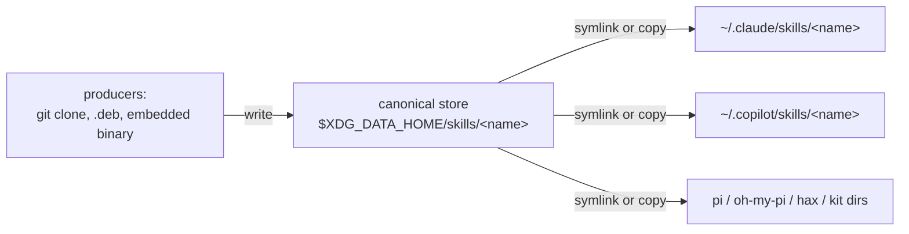

# skills-mapper — VISION

## What this is

AI coding agents have converged on a skill *format* — a `SKILL.md` directory —
but not on a *location*. **skills-mapper** (two Go binaries, **`sm`** and
**`ms`**) closes that gap by inverting the model: declare one canonical, agent-neutral place where skills
live, and make every agent's proprietary skills directory a derived view of it.

This VISION captures the problem and the solution. The agent-neutral store is
specified on its own in [`SKILLS-DIRECTORY-SPEC.md`](SKILLS-DIRECTORY-SPEC.md);
the design of `sm` and `ms` is in [`docs/DESIGN.md`](docs/DESIGN.md), and the
user reference is [`README.md`](README.md).

## The problem

A skill is portable; its *location* is not. Each agent reads only its own
directory:

- Claude Code: `~/.claude/skills/`
- Copilot, pi, oh-my-pi, hax, kit, …: each its own path

There is no ratified cross-agent skills directory. So to give N agents the same
skills, you copy or symlink into each agent's directory individually, and every
tool that ships skills must know about every agent. That per-agent knowledge,
smeared across every producer, is the thing we keep rebuilding.

The closest existing standards leave the gap open:

- **`SKILL.md`** — a converging skill *format*, but it says nothing about where
  the folder lives.
- **`AGENTS.md`** — widely adopted, but it is the repo-root *instructions* file,
  not a skills directory.
- **XDG Base Directory Specification** — the authority on where user data goes
  on Linux (`${XDG_DATA_HOME:-~/.local/share}`). No skills convention has
  claimed a subpath, but it is the obvious neutral home.

## The solution: one canonical store, fan-out to agents

Declare the standard: skills live in one place,

```
${XDG_DATA_HOME:-~/.local/share}/skills/<name>/SKILL.md
```

and make every agent's proprietary entry a link back to that canonical copy (or,
where a link cannot reach, a managed copy of it).



Why this wins:

- **One source of truth.** Upgrade a skill in the store once; every agent sees
  it, because its entry is just a link back.
- **Producers get a stable target.** A tool that bundles a skill writes to the
  store. It never needs to know about Claude vs Copilot vs pi.
- **Proprietary knowledge is isolated** in one place — the fan-out — not smeared
  across every producer.
- **Graceful path to a real standard.** The day an agent reads
  `$XDG_DATA_HOME/skills` directly, stop fanning out to it; the canonical copy
  is already in the right place.

## Two artifacts, two jobs

1. **The store standard** — [`SKILLS-DIRECTORY-SPEC.md`](SKILLS-DIRECTORY-SPEC.md).
   Agent-neutral. Defines only *where* skills live and *what* a skill directory
   is. It mentions no tool, no symlinks, no fan-out — any agent or producer can
   adopt it on its own.

2. **`sm`, the transition tool** — [`docs/DESIGN.md`](docs/DESIGN.md). Until
   agents read the store natively, `sm` mirrors the store into each agent's
   proprietary directory — with symlinks, or with real copies (`--copy`) for
   sandbox and container homes — and keeps that mirror reconciled. Its job is
   placement, nothing more: list the store, link or copy into each agent,
   reconcile. It does **not** populate the store, fetch anything, or transform
   skills.

### `ms`, the ingest complement

`sm` goes store to agents; it never populates the store. `ms` is the other
direction: it ingests an existing agent install (today, a Claude Code skills tree
including the standard skill folders nested inside plugin trees) into the store,
normalizing each skill to the directory spec and leaving no marker in the store;
its provenance goes to a private ingest log instead. A user with skills already
in one agent can run `ms` once and then let `sm` fan them out to the rest. It is
still a transition aid: the store stays neutral, and `ms` is just one more
producer. See [`docs/DESIGN.md`](docs/DESIGN.md).

## What changed from the earlier design

The earlier `sm` was manifest-driven. You declared git and local sources in a
`skills.toml`, and `sm` cloned them into a durable cache, discovered skills
across sources, resolved name collisions, and fanned the result out to agents.
That made `sm` both a package manager and a placer.

The new model removes the source manifest and all fetching. Skills arrive in the
store by whatever means a producer chooses — `git clone` by hand, a `.deb` that
stages into it, a binary that writes its embedded `SKILL.md`. `sm`'s only job is
**store → agents**. This deletes the clone cache, cross-source discovery, and
collision/resolve logic entirely: the flat store makes each skill name unique by
construction, so there is nothing to resolve.

What `sm` is told is which agents to mirror into. That lives in a new, narrow
config — `agents.toml`, a plain list of agents and their skills folders — not a
source manifest. `sm` can populate it for you by probing for the agents already
installed on the machine. `sm` also keeps a private state file
(`$XDG_DATA_HOME/skills-mapper/state.json`) recording every link and copy it
makes; that record is the basis of the safety model below, because `sm` removes
only what it recorded and can still identify as its own. The store itself
stays neutral and holds nothing of `sm`'s.

## Philosophy

- **One standard, no drift.** The point is that skills follow a single standard
  every coding tool reads. There is **no plugin *format* support** — bridging one
  agent's plugin format would let its users consume skills others can't,
  re-creating the drift `sm` exists to kill. `ms` only lifts out the standard
  skill folders it finds inside plugin trees, and flags them as third-party.
- **Adaptation is placement, not transformation.** Because there is one
  standard, "adapt to each agent" collapses to putting the standard files where
  each agent looks — symlinks, or real copies (`--copy`) when the destination is
  a sandbox or container home a symlink could not reach into.
- **Maximally dumb and neutral.** `sm` sees a directory of skills it did not
  create and mirrors it. It never populates the store.
- **Safety by provenance.** `sm` only ever removes or replaces an entry it
  recorded and can still identify as its own (the exact link target, or a copy
  marker naming the recorded store path). It never clobbers a hand-placed skill
  or an agent's own files.
- **Skills are trusted code.** A skill is instructions an agent will follow
  with the agent's permissions, and the store hands every skill to every agent.
  What enters the store must be reviewed; `ms` says when it ingested plugin
  (third-party) skills and records where every ingested skill came from.

## Non-goals

- **Populating the store** — producers do that; `sm` never fetches or writes
  skills into the store.
- A skills registry or marketplace.
- Editing agent configuration beyond the skills directory.
- Dependency resolution between skills.
- **Project scope** — v1 is a single user-global store. Project-local stores are
  a possible later addition.
- Windows and untested platforms — v1 targets Linux (tested) and macOS (builds,
  untested). Windows is untested and unsupported
  (symlinks need extra privileges there, and `--copy`, which exists for sandbox
  and container homes, is not a supported Windows path either).
