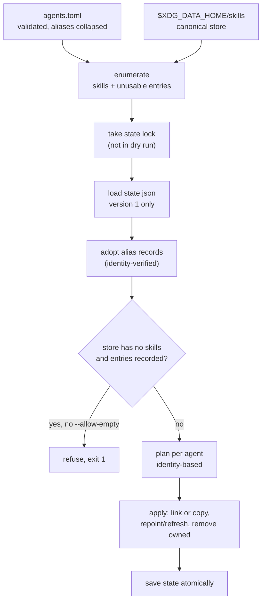
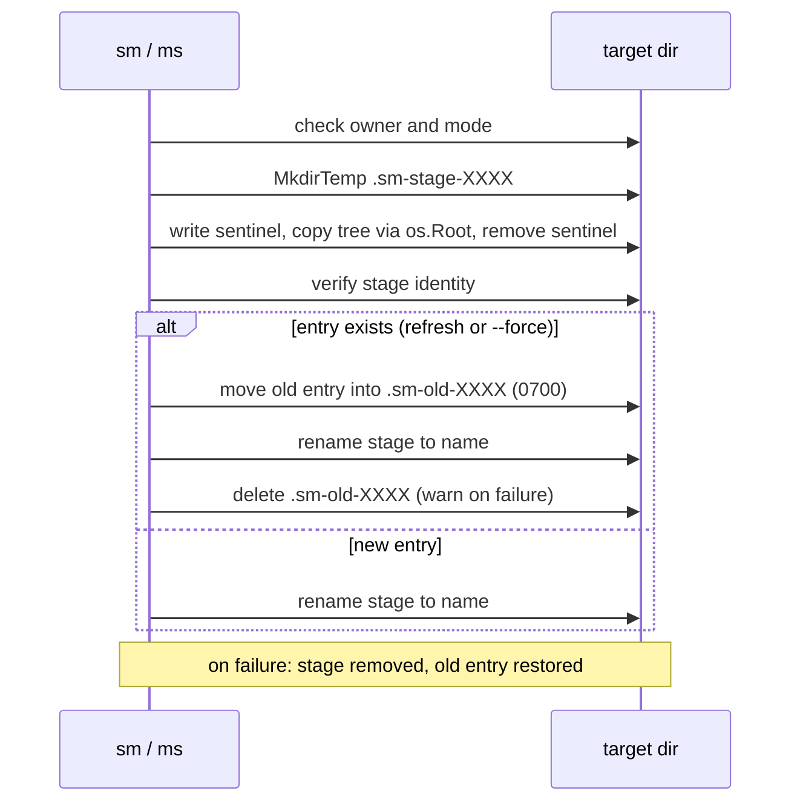
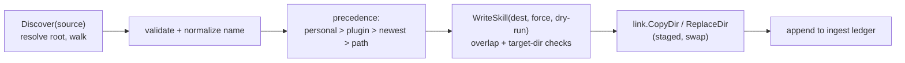

# skills-mapper (`sm` and `ms`) — DESIGN

- **Status:** implemented (v1).
- **Date:** 2026-10-20.

See [`../VISION.md`](../VISION.md) for the problem and solution,
[`../SKILLS-DIRECTORY-SPEC.md`](../SKILLS-DIRECTORY-SPEC.md) for the
agent-neutral store this design consumes, and [`../README.md`](../README.md)
for the user-facing reference (the flags and the user-visible messages quoted
here are listed there, in the command reference and Troubleshooting sections).

## Purpose

`sm` mirrors the canonical skills store into each agent's proprietary skills
directory, as symlinks or (with `--copy`) as real copies, and keeps that mirror
reconciled. It is the transition tool that serves one library of skills to
every agent until agents read the store directly.

`sm` does **not** populate the store and does **not** fetch anything. Skills
arrive in the store by a producer's means (a `git clone`, a `.deb`, a binary
writing its embedded `SKILL.md`, or `ms`); `sm`'s only job is **store → agents**.

`ms` is the companion binary for the opposite direction: a one-off ingest of the
skills an agent already has into the store (see [`ms`](#ms--ingest-into-the-store)).

## Scope (v1)

- **Global only.** One store at `$XDG_DATA_HOME/skills/`, fanned out into each
  agent's user-global skills directory.
- **Linux and macOS.** Linux is tested; macOS builds but is untested. Symlink
  fan-out by default, with a **`--copy` mode** that materializes real
  directories for sandbox and container homes a symlink cannot reach into.
- **Windows is untested and unsupported.** The packages compile there (the
  Unix-only ownership check, lock and state-directory tightening have no-op
  stubs), but symlink mode needs extra privileges and nothing is tested.

## Non-goals (deliberate)

- **No store population by `sm`.** `sm` never writes a skill into the store.
- **No fetching.** No clone cache, no `git pull`, no source manifest (see
  [Removed from the earlier design](#removed-from-the-earlier-design)).
- **No transformation.** Placement only; the files are already standard.
- **No plugin *format* support.** No agent's plugin or registry format is read
  or bridged. `ms` does extract the standard skill folders it finds inside
  plugin trees (for example `~/.claude/plugins/...`), and flags them as
  third-party.
- **No project scope** in v1.

## Core model

`sm sync` runs these steps:

1. **enumerate** — list the conforming skill directories in the store.
2. **adopt** — move identity-verified records from other spellings of an
   agent's directory to the spelling `agents.toml` uses now.
3. **guard** — refuse an empty store that would prune everything recorded.
4. **plan and apply** — per agent, create the missing entries, repoint or
   refresh the owned ones, remove owned entries no longer backed by a store
   skill; never touch anything `sm` cannot identify as its own.
5. **save state** — atomically.



There is no discover-across-sources step and no collision/resolve step: the flat
store (one directory per skill) makes each skill name unique by construction.

## Configuration — `agents.toml`

The only configuration file. Global, at
`$XDG_CONFIG_HOME/skills-mapper/agents.toml` (default
`~/.config/skills-mapper/agents.toml`; a relative `$XDG_CONFIG_HOME` is ignored).
It is a plain map of agent name to that agent's skills directory:

```toml
[agents]
claude-code = "~/.claude/skills"
copilot     = "~/.copilot/skills"
hax         = "~/.config/hax/skills"
```

- An agent is **enabled** by its presence in the map. To stop mirroring into an
  agent, remove or comment its line, then `sm clean --orphans`.
- The **value is the skills directory**, so an **unknown agent name is valid** —
  there is no registry lookup at sync time.
- Values expand a leading `~` and `$VAR` / `${VAR}`. The `~` is recognised on
  the value as written, and variables are expanded on the remainder, so a `~`
  that comes out of a variable's value stays literal (and the result is then
  rejected as not absolute). A variable that is unset
  **or set to the empty string** is an error
  (`undefined or empty environment variable $X in "..."`), and the result must
  be absolute.

The file is validated strictly so a mistake fails loudly instead of syncing the
wrong thing:

- **Only the `[agents]` table.** Any other top-level key or table is an error
  naming the keys (`unknown key(s) <keys> (agents are declared under [agents])`),
  so a typo such as `[agent]` is caught. `agents` that is not a table is also
  an error.
- **No over-broad directories.** `/`, `$HOME`, and any ancestor of `$HOME` are
  refused. The check runs on the expanded value at load time and again on the
  symlink-resolved directory (against the resolved home, or the `--agent-home`
  root), so a symlink alias of home cannot slip through.
- **No overlap with the store.** An agent directory that equals, lies inside,
  or contains the (resolved) store is refused.
- **Aliases collapse.** Agents are processed in name order; a later agent whose
  directory resolves to the same real directory as an earlier one is dropped
  with `sm: warning: agent <b> maps to the same directory as agent <a> (...); syncing
  it once under <a>`. `sm clean --agent <b>` then fails with
  `agent <b> shares a directory with agent <a>; use --agent <a>`.
- **CLI path flags** (`--store`, `--agent-home`) expand only `~`, never
  variables (the shell already expanded them). `--agent-home` is
  symlink-resolved.

## Built-in agent registry

`sm` ships a table of well-known agents and their default skills directories.
This registry is used only to *suggest* entries during `sm probe` and
`sm init` — the authoritative active set is always `agents.toml`.

| Agent | Default skills directory | Presence signal |
| --- | --- | --- |
| `claude-code` | `~/.claude/skills` | `~/.claude` exists or `claude` on `PATH` |
| `copilot` | `~/.copilot/skills` | `~/.copilot` exists or `copilot` on `PATH` |
| `hax` | `~/.config/hax/skills` | `~/.config/hax` exists or `hax` on `PATH` |
| `pi` | `~/.pi-go/skills` | `~/.pi-go` exists or `pi` on `PATH` |
| `oh-my-pi` | `~/.config/agents/skills` | `~/.config/agents` exists or `omp` on `PATH` |
| `kit` | `~/.config/kit/skills` | `~/.config/kit` exists or `kit` on `PATH` |

Adding a known agent is one registry entry. The registry is suggestions only; it
never gates sync.

## Commands

| Command | Flags | Does |
| --- | --- | --- |
| `sm sync` | `--dry-run`, `--copy`, `--store DIR`, `--agent-home DIR`, `--allow-empty` | Enumerate the store, adopt alias records, link (or copy) into each enabled agent, reconcile. The everyday verb. |
| `sm status` | `--store DIR`, `--agent-home DIR` | Read-only report: store skill count and warnings; per agent `owned`, `missing`, `unmanaged`, `dangling`; without `--agent-home`, the unmapped state targets. |
| `sm clean` | `--agent NAME`, `--agent-home DIR`, `--orphans` | Remove the entries `sm` recorded and can still identify, for every agent, one agent, a re-rooted layout, or only the unmapped targets. |
| `sm probe` | `--yes`, `--dry-run` | Detect installed agents and offer to add each unlisted one to `agents.toml`. |
| `sm init` | none | Write a starter `agents.toml` (registry defaults, commented out); never overwrites. |

CLI conventions:

- `-v` / `--verbose` may appear anywhere and prints one line per action on
  stderr; summaries go to stdout, warnings and errors to stderr.
- **Usage errors are exit `2` and happen before anything is read or written.**
  A flag explicitly given an empty value (`--store ""`, `--agent ""`,
  `--agent-home ""`; detected with `flag.Visit`, so an unset shell variable
  cannot widen scope) is `sm <cmd>: --<flag> must not be empty`; `sync`,
  `status`, `clean`, `probe` and `init` take no positional arguments
  (`sm <cmd>: unexpected argument "<x>"`), because flag parsing stops at the
  first positional and `sm clean a` or `sm sync now --dry-run` would otherwise
  silently ignore the rest. `ms` refuses an empty source or destination
  (`ms: source must not be empty`).
- `sm -h`, `sm --help`, `sm help` and `sm <command> -h` print usage to stdout
  and exit `0`; `sm` with no arguments prints usage to stderr and exits `2`.
  `sm init` rejects any flag or argument, and `sm init -h` never writes.
- The one-line summaries in `sm -h` say "link"/"linked" although `sync` also
  copies and `status` also counts copies (`owned`), and `ms -h` says "proprietary
  agent skills folder" for an agent's own skills folder; the help is
  deliberately terse and the README is the reference.
- Exit codes (both binaries): `0` success, `1` operational error, `2` usage
  error.
- The `(run 'sm init' to create one)` hint is printed only when the config file
  does not exist; `sync` with zero agents prints `no agents enabled in
  agents.toml`.

### `sm probe`

For each registry entry whose presence signal fires and that is not already in
`agents.toml`, prompt on stdout:

```
add <name> (<absolute skills dir>)? [y/N]
```

Only `y`/`yes` accepts. `sm probe` only ever **adds** entries; it never removes
one, and never touches the store or any agent directory. `--yes` accepts all;
`--dry-run` prints `would add <name> (<dir>)` per candidate and
`dry run: <n> agent(s) would be added; nothing written`.

Layout rules (the file is edited line by line, so comments and layout survive):

- The existing file must load cleanly under the rules above; an invalid file is
  refused and left unchanged.
- New entries are inserted at the end of the existing `[agents]` table; the
  header is appended when the file has none, and a missing file is created
  only when something is added.
- An inline or dotted `agents` table (`agents = { ... }`) is refused
  (`agents.toml declares "agents" as an inline or dotted table; edit the file by
  hand`).
- Multi-line strings and arrays are skipped while scanning, so a look-alike
  header inside a value is not mistaken for the table.
- Names and directories are TOML-escaped (names quoted when not bare keys).
- The layout and values are validated **before** any prompt, and the write is
  atomic: a temp file in the same directory, `fsync`, then rename. The file's
  mode is preserved, and a symlinked `agents.toml` is resolved so the link
  survives and its target is replaced.

### `sm sync`

Load `agents.toml`; enumerate the store; for each enabled agent (creating the
agent's skills directory if missing), realize the desired entries and reconcile.
Summary per agent:

- **Symlink mode:** `sync: <agent> +N -M`, plus ` ~R` only when `R` links were
  repointed (the store path behind a recorded link changed, for example after
  `--store`).
- **Copy mode:** always `sync: <agent> +N ~R -M`, where `~R` counts copies
  refreshed from the store (every owned copy is re-copied on every `--copy`
  sync).

```
sync: claude-code +3 -0   copilot +3 -1
sync: claude-code +0 -2 ~1
sync: claude-code +3 ~2 -0
```

`--dry-run` reports the same counts and warnings a real run would produce
(except that it does not check target-directory safety: with a world-writable
agent directory it reports counts and exits `0` where a real run refuses),
writes nothing (including state) and takes no lock. `-v` lines:
`<agent>: linked|relinked|unlinked|copied|refreshed|removed copy <name>`,
`<agent>: dropped record for <name> (link already gone)`,
`<agent>: swept <n> orphaned stage dir(s)`.

`--store DIR` reconciles the real agent directories against `DIR`.
`--agent-home DIR` re-roots every agent directory from `$HOME` into `DIR`
(`~/.claude/skills` becomes `DIR/.claude/skills`), so a process started with
`HOME=DIR` finds its skills; an agent outside `$HOME` cannot be re-rooted and is
an error. The re-rooting works on the path as `agents.toml` spells it (matched
against both the unresolved and the resolved `$HOME`), so the conventional
spelling should be kept: a resolved-symlink spelling no longer yields the
layout a `HOME=DIR` process expects, and a later respelling turns earlier
layouts into orphaned targets (see `status` below).

A copy-mode `--dry-run` never reads file contents, so it reports the same
counts but cannot predict warnings about skipped entries inside a skill or
read errors; those appear only in a real run.

**Failure isolation.** In copy mode a per-skill create or refresh error
(an unreadable file, say) is recorded and the run continues: the other skills
and agents are processed, the state is saved, the summary is printed, and the
command prints `sm: sync failed:` with one `agent <a>: <skill>: <error>` line
per failure (joined errors keep their line breaks) and exits `1`. Failures
that undermine the run itself (a probe or identity error, an unusable agent
directory, a lock or state error) still stop it, with the progress made so far
saved. `ms` isolates per skill the same way (see below).

**Alias-record adoption.** State is keyed by the agent directory as spelled.
When the spelling in `agents.toml` changes but resolves to the same real
directory (for example `~/.claude/skills` becomes `~/claude/claude/skills`
because `~/.claude` is a symlink), `sync` moves each record from the old key to
the new one when the entry still verifies by identity at the agent directory,
and prints one line per old key (always, not only with `-v`):

```
adopted <n> record(s) from <old dir> into <dir>
```

`--dry-run` prints `would adopt ...` and saves nothing. Only the ledger of the
mode being synced moves; a name the new key already records keeps its own
record if that record still verifies (otherwise the verified record from the
old key replaces it); a record whose entry no longer verifies stays under the old key. An old
key left empty is dropped. Adoption runs before the empty-store guard, so
adopted records count toward it.

### `sm status`

Never changes anything and takes no lock. Columns per agent:

| Column | Meaning |
| --- | --- |
| `owned` | Store skills present as `sm`'s own link or copy (by identity). |
| `missing` | Store skills not present yet. |
| `unmanaged` | Store skills whose name is held by an entry `sm` did not create or no longer recognizes. |
| `dangling` | `sm` links that no longer resolve, or records for skills that left the store. |

Without `--agent-home`, state targets that `agents.toml` does not map are
classified (re-rooted keys never match the configured ones, so classification
is skipped under `--agent-home`):

| Line | Classification |
| --- | --- |
| `orphaned target: <dir> (<n> entries)` | Not related to any configured agent: an agent removed from `agents.toml`. |
| `aliased target: <dir> (same directory as agent <name>)` | Resolves to the real directory of a configured agent: an older spelling. |
| `provisioned target: <dir> (<n> entries; clean with: sm clean --agent-home <root>)` | Ends with a configured agent's home-relative path (longest match wins): a `--agent-home` layout. |
| `unclassifiable target: <dir> (<reason>)` | The key cannot be resolved (for example a symlink loop or an unreadable parent). |

Classification uses the agents configured now: a `--agent-home` layout of an
agent later removed from `agents.toml`, or whose directory was respelled so it
no longer ends with the same home-relative path, no longer matches and is
reported (and cleaned) as an orphan. The home-relative match accepts both the
unresolved and the symlink-resolved `$HOME`, so a layout made under a symlinked
home still reads as `provisioned`. A removed agent whose directory merely ends
with a configured agent's relative path is also labelled `provisioned` and is
never removed by `--orphans`; clean it with `--agent-home`.

### `sm clean`

Takes the lock, first adopts records kept under another spelling of each
in-scope agent's directory (the same identity-verified step `sync` runs), then
removes every recorded entry that still verifies by identity; anything else is
left on disk and its record dropped. With no agent configured it prints `no
agents enabled in agents.toml`. Removal checks the agent directory without
creating it (a missing directory is fine); a world-writable or foreign-owned
one is refused with a hint (`sm clean --agent <other>` for the remaining
agents when the run is unscoped). Per-entry lines
(`<agent>: unlinked <name>`, `<agent>: removed copy <name>`) go to stderr, the
summary (`clean: <agent> -N ...`) to stdout. Agent directories are left in
place.

- `--agent NAME` limits it to one configured agent (`unknown agent "<name>"`
  otherwise).
- `--agent-home DIR` cleans the layout re-rooted under `DIR`.
- `--orphans` acts only on unmapped targets: **orphans** have their entries
  removed (identity-checked) and their key dropped; **alias** keys have their
  identity-verified records merged into the live agent's key
  (`merged <n> record(s) from <old> into <dir>`) and the duplicate key dropped
  (`<old>: same directory as agent <a>; dropped its duplicate record, removed
  nothing`), removing nothing on disk; **provisioned** targets are reported
  (`<dir>: provisioned with --agent-home; left alone (clean with: sm clean
  --agent-home <root>)`) and left alone, and so are **unclassifiable** ones. With nothing to do it prints
  `clean: no orphaned targets`. `--orphans` cannot be combined with `--agent`
  or `--agent-home` (usage error, exit `2`).

## Store enumeration

The store's skills are its **immediate** subdirectories that conform to the
spec: a directory (a symlinked directory counts) whose name matches
`^[a-z0-9]([a-z0-9-]*[a-z0-9])?$` (`skillmeta.NamePattern`), containing a
`SKILL.md` whose frontmatter `name` equals the directory name.

- Entries whose name begins with `.` (such as `.git`, or a leftover
  `.sm-stage-*`) are ignored silently, so a git checkout works as a store.
  Regular files in the root are ignored silently.
- `SKILL.md` must be a regular file (a symlink to one is fine) of at most
  1 MiB; it is opened non-blocking and re-checked on the open handle, so a FIFO
  or device cannot hang or exhaust `sm`. A UTF-8 BOM and trailing spaces, tabs
  or CR on the `---` lines are accepted. The frontmatter must be valid YAML.
- Any other non-conforming or unreadable entry is **warned** about and recorded
  as **unusable** — not absent. A recorded entry whose store entry is unusable
  is kept (`warning: <agent>: keeping <path>: its store entry is unusable (see
  the store warning)`), so a temporarily broken skill never loses its links.
- If the store directory does not exist or cannot be read, `sm` exits `1`
  before touching any agent: `sync` prints `warning: read skills store: ...; no
  changes made` and then `sm: sync failed: read skills store: ...`; `status`
  prints only `sm: status failed: ...`.
- **World-writable store.** `sync` (every mode, dry run included) refuses a
  world-writable store: `store <dir> is world-writable; refusing`. Group-writable
  stores and read-only stores owned by someone else stay legal (a shared
  library). `status` is read-only and does not check.
- A regular file at a store entry name is ignored silently (it is not a skill),
  so recorded entries under that name are pruned like any removed skill.
- **Source identity.** Enumeration records, for each skill, the identity of its
  real directory (`os.Stat`) and of the `SKILL.md` it parsed (the open handle's
  `FileInfo`). Copy mode passes them to `internal/link`, which re-checks them
  when it opens the source (see Write safety).
- **Empty-store guard.** If the store has zero skills while state records
  entries (in the ledger of the mode being synced) for an in-scope agent,
  `sync` refuses: `store <dir> has no skills, but sm recorded entries for <agent>
  (<n>); refusing to remove them (pass --allow-empty if the store is meant to be
  empty)`. An agent is exempt only when **every** recorded name of the in-scope
  ledger is among the unusable entries, which shows the real store with a
  temporary problem; a mistyped `--store` full of unrelated directories (even
  one that happens to hold a directory named like one recorded skill) therefore
  cannot defeat the guard. `--allow-empty` lets the empty store prune
  everything.

## Placement, state, and reconciliation

### Placement

- **Link (default).** For each enabled agent and each store skill, create a
  whole-directory symlink `<agent dir>/<name> -> <store>/<name>` (the store path
  as given, not resolved). `<name>` must be a single clean path segment. Before
  creating or repointing any link, the agent directory must pass the
  target-directory check below.
- **Copy (`--copy`).** Materialize a real copy of the store skill at
  `<agent dir>/<name>`, carrying a hidden `.sm-copy` marker whose content is the
  store path. A symlinked store skill is resolved first and copied as its real
  tree. A root `SKILL.md` that is itself a symlink is **dereferenced**: the
  copy holds a regular `SKILL.md` with the manifest's content, so a copy is
  never a skill without its manifest (the store is the user's own data; `ms`,
  which ingests possibly untrusted trees, takes the opposite policy). The
  manifest must be a regular file of at most 1 MiB and must still be the file
  that was validated (same identity, size and modification time), otherwise
  `SKILL.md changed since it was validated: <path>`. A link chain is limited to
  8 links, the limit of `os.Root`, and a manifest reached through a directory
  symlink that is absolute or leaves the skill fails with `path escapes from
  parent` (a known, documented limit; a relative directory link that stays
  inside the skill works). Every `--copy` sync refreshes each owned copy (re-copies
  it), discarding any local edit made inside a copy. Copies are
  recorded in a separate `copies` ledger so the two modes reconcile
  independently; an entry recorded by the other mode is skipped with
  `managed by sm in <mode> mode; run 'sm clean' to switch this directory to
  <mode> mode`.
- **Symlink mode and absolute links.** A link is made to the whole store
  directory, so an absolute symlink inside a store skill is not filtered in
  symlink mode: the agent follows it wherever it points.

### Write safety (copy mode and `ms`)

Every copy — `sm sync --copy` and every skill `ms` writes — goes through one
routine in `internal/link`:

- **Target-directory check.** The directory written into (an agent directory,
  or the resolved `ms` destination) is created `0755` if missing and must be a
  directory owned by the current user and not world-writable (group-writable is
  allowed); otherwise `refusing target dir <dir>: not owned by the current
  user` / `world-writable` / `not a directory`. Only that directory is checked,
  not its ancestors. The refusal carries a hint
  (`world-writable (fix with: chmod o-w '<dir>')`, `not owned by the current
  user (the directory must be owned by you)`); `sync` adds that it stops at that
  agent, `clean` the `sm clean --agent <other>` hint for the other agents (only
  when unscoped and others exist). Removal paths (`RemoveIfTarget`,
  `RemoveCopy`, the sweep) run the same rules without creating the directory
  (a missing directory is fine), so `clean` and link-mode removals also refuse
  in an unsafe directory. Link-mode `sync` checks the directory only when it
  has something to create, repoint or remove.
- **Pinned source.** Each copy function takes the identity captured when the
  skill was validated (`link.StorePin{Dir, Manifest}` for `sm`, the identity from
  `Discover` for `ms`). After resolving the source and opening it as an
  `os.Root`, it requires `os.SameFile` against that identity
  (`source changed since it was validated: <path>`; a nil identity is an error)
  and reads only through that handle, so a directory swapped for a symlink to
  somewhere private between validation and copy is refused. For a dereferenced
  `SKILL.md` the opened manifest must additionally match the pinned identity,
  size and modification time. The residual is an edit that keeps all three, or
  a recycled inode with the same size and time (low risk).
- **Overlap guard.** The resolved source must not equal, lie inside, or contain
  the resolved destination directory (`refusing to copy <src> to <dst>: the
  destination overlaps the source`); otherwise a store skill that is a symlink
  to the agent directory (or a parent) would stage a copy of itself without end.
- **Random stage beside the target.** The copy is built in a fresh
  `.sm-stage-*` directory created with `os.MkdirTemp` in the target directory
  (same filesystem, so the final move is a rename). The stage is verified to be
  a real directory owned by the user, a sentinel file is written first, and
  every write goes through an `os.Root` opened on the stage, so a planted
  symlink cannot redirect a write. Directories are created with `Mkdir` and
  files with `O_EXCL`.
- **Filtered content.** Source entries are read through an `os.Root` on the
  resolved source. Named pipes, sockets and devices are skipped with a warning;
  a symlink inside the skill is copied only when it is relative and stays
  inside the skill, otherwise skipped with a warning; a root-level `.sm-copy`
  or stage sentinel in the source is never copied. Copied files and
  directories lose group/other write bits, and setuid, setgid and sticky bits
  are never carried. Messages that print untrusted names or symlink targets
  escape control characters, bidi controls and invalid UTF-8 (`pathutil.Printable`;
  `PrintableLines` keeps the line breaks of joined errors), so a crafted name
  cannot rewrite the terminal or forge a `note:` line.
- **Identity check before rename.** The sentinel is removed, the stage is
  re-checked to still be the directory that was created, and only then renamed
  into place. A stage is removed on every failure path.
- **Replacement is a swap.** To refresh a copy (or `ms --force`), the new tree
  is built completely first; the old entry is then moved into a private
  `.sm-old-*` directory (`0700`), re-verified there (a refresh re-checks the
  marker), and the new tree renamed in. If placing the new tree fails, the old
  entry is restored. The old entry is deleted only after the new one is in
  place; if that delete fails, it is a warning
  (`previous version kept at <path>; remove it manually (...)`), never an
  error. `.sm-old-*` directories are never deleted automatically.
- **Deletion through handles.** A stage or set-aside directory is removed by
  opening it as an `os.Root` after checking (`Lstat`, `SameFile` against the
  recorded identity) that it is the directory that was created, deleting its
  children through that handle with `Root.RemoveAll`, and then removing the
  empty directory through a handle on its parent (`Root.Remove`, an rmdir that
  can never take content). A path swapped in after the check is never
  recursed into, so a group writer of the target directory cannot cause `sm` to
  delete one of the owner's other directories by renaming it into a `.sm-stage-*`
  or `.sm-old-*` name. The only residual is that, between the check and the
  rmdir, an empty directory could be swapped in and removed (Linux has no
  rmdir by handle).
- **Ownership of copies.** `IsOwnedCopy` requires the copy directory and its
  marker to be owned by the current user (unix; a no-op elsewhere) in addition
  to the marker content naming the recorded store path. The forgeable part is
  the marker text, so a same-owner process can still imitate a copy
  (residual below).
- **Sweep.** Before working, a copy-mode sync removes orphaned `.sm-stage-*`
  directories in the agent directory, but only real directories owned by the
  user that still carry the sentinel; ones it cannot inspect or remove are
  warnings. `ms` does not sweep (a leftover stage in the store is a dot entry
  that consumers ignore).



### State

One central file at `$XDG_DATA_HOME/skills-mapper/state.json` (default
`~/.local/share/skills-mapper/state.json`). The store itself stays neutral at
`skills/`; nothing of `sm`'s lives there.

```json
{
  "version": 1,
  "targets": {
    "/home/u/.claude/skills": {
      "links": { "emoji": "/home/u/.local/share/skills/emoji" },
      "copies": { "pdf-tools": "/home/u/.local/share/skills/pdf-tools" }
    }
  },
  "updated_at": "2026-10-20T17:27:27Z"
}
```

- **Keys** are absolute agent directories as spelled in `agents.toml` (symlinks
  not resolved); under `--agent-home` the home is symlink-resolved first.
  `links` and `copies` map a skill name to the store path recorded when the
  entry was made; `copies` is omitted when empty.
- **Version.** `version` must be `1`. Any other value, a missing version, or a
  `null` document is refused (`unsupported state version ...; refusing to use or
  overwrite it`), as are relative keys, keys that are not clean paths
  (`filepath.Clean(key) != key`: a `..` segment, a doubled or trailing
  separator: `target directory "<dir>" is not a clean path`), names that are not a
  single path segment, and empty recorded values. A version-1 document whose
  `targets` is absent or `null` is corruption (`version 1 document has no
  targets object`) because accepting it would silently drop all provenance;
  `"targets": {}` loads. A missing file is an empty state.
- **Modes.** The state directory is created `0700`, and `sync`/`clean` tighten
  an existing one the user owns to `0700` (earlier releases made it `0755`).
  The state file is written `0600` via a temp file and rename, so a crash never
  leaves a truncated file; there is no `fsync` before the rename, so a power
  loss can still lose the latest save.
- **Lock.** `sync` (not in dry run), `clean` and `ms` (not in dry run) take an
  exclusive, non-blocking `flock` on `state.json.lock` (`0600`, opened with
  `O_NOFOLLOW`) for the whole load-modify-save (for `ms`, the whole write), so
  the three never overlap. The lock is labelled with the tools that take it; a
  second run fails at once: `another sm or ms process is running (lock <path>)`.
  `ms` additionally takes the ingest ledger lock, always after the state lock
  (`sm` never takes the ledger lock, so there is no deadlock); a concurrent
  `ms` blocked there sees `another ms process is running (lock <path>)`, and a
  running `ms` does not block `sm` on the ledger lock. `status`, `probe`,
  `init` and dry runs do not lock.
- **Partial progress is saved.** When an agent fails mid-run, the state made so
  far (earlier agents included) is saved before the error is returned, so state
  keeps matching the filesystem. Isolated per-skill copy failures are saved the
  same way and do not stop the other skills or agents (see `sm sync`).

### Reconcile (identity-based provenance)

The planner (`state.PlanTarget`) is pure: it takes the desired set, the
recorded ledger and an inspect callback, and returns create / repoint / keep /
remove / unmanaged / lost. Ownership is **identity**, never type:

- a recorded **link** is `sm`'s only while its raw `readlink` equals the
  recorded target string;
- a recorded **copy** is `sm`'s only while it is a real directory whose
  `.sm-copy` marker is a regular file (at most 4 KiB) whose trimmed content
  equals the recorded store path. Records and markers written by the previous
  release match.

Outcomes:

| Situation | Action |
| --- | --- |
| Desired, absent | Create (also self-heals a recorded entry the user deleted). |
| Desired, owned, same store path | Keep (copy mode: refresh). |
| Desired, owned, store path changed | Repoint (link mode: remove then create, `~R`); copy mode: refresh. |
| Desired, present, not recorded | Unmanaged: warn `exists and is not managed by sm; skipping`, never overwrite. |
| Recorded, present, no longer owned | Lost: drop the record, leave the entry, warn `is no longer an sm link` / `sm copy`. |
| Recorded, not desired, owned or gone | Remove (a gone link counts as removed; `-v` says `dropped record`). |
| Recorded, store entry unusable | Withheld from the planner; entry and record kept. |

Removal is itself identity-safe: the entry is moved into a private `.sm-old-*`
directory, re-verified there, and only then deleted; if it changed in between
it is restored.

## Architecture (packages)

```
cmd/sm/                 sm entrypoint
cmd/ms/                 ms entrypoint
internal/cli/           sm commands: sync, status, clean, probe, init; flag overrides, alias adoption, orphan classification
internal/agents/        built-in registry; agents.toml load, strict validation, expansion, starter file
internal/store/         enumerate the store: skills, warnings, unusable entries (reads the filesystem directly)
internal/skillmeta/     SKILL.md frontmatter reading and the skill name pattern (shared by sm and ms)
internal/probe/         agent presence detection; line-based, atomic agents.toml update
internal/link/          symlink create/probe/identity-checked remove; staged copy, swap, sweep; target-dir ownership check
internal/state/         state file (version, validation, atomic save), pure reconcile planner, run lock
internal/pathutil/      ~ expansion, symlink resolution of existing ancestors, containment and overlap checks
internal/ingest/        ms: recursive discovery and precedence, skill writing, ingest ledger
internal/mscli/         ms command line
```

The pure core is the `state` reconcile planner, unit-tested in isolation with a
fake inspect function. Everything else does real filesystem I/O and is covered
by hermetic tests over temporary directories.

## `ms` — ingest into the store

`ms` is a second binary (`cmd/ms`, wiring in `internal/mscli`, logic in
`internal/ingest`). It is the inverse of `sm`: proprietary source tree to store.
It never touches agent directories or `agents.toml`; its only contact with
`sm`'s state is taking the state lock (a real run), so it cannot overlap a
`sync` or `clean`.



CLI: `ms [flags] [--] <source> [dest]`; `dest` defaults to the canonical store.
Flags: `--format` (default `claude-code`, the only implemented format; others
are `unsupported source format`), `--force`, `--dry-run`, `-v`/`--verbose`,
`--follow-symlinks`. Flags may come before or after the paths; `--` ends flag
parsing (even directly after `--format`). `-h`/`--help` prints usage to stdout
and exits `0`; a bad flag or wrong argument count prints usage to stderr and
exits `2`; an empty source or destination is a usage error too. Paths expand
only `~`; a `$VAR` stays literal.

- **Discovery.** The source root is symlink-resolved (a symlinked `~/.claude`
  works). A recursive walk finds every directory containing `SKILL.md`, stops
  descending at a found skill, and prunes `.git`, `node_modules`, `vendor`,
  `dist` and `build`. Unreadable subdirectories are warned about and skipped;
  an unreadable root is an error.
- **Symlinks.** Symlinked directories inside the tree are skipped with
  `skipping symlink <path> (use --follow-symlinks)`. With `--follow-symlinks`
  they are followed, also outside the source; a link to an ancestor of the
  source is refused; a real directory reached twice is ingested once
  (`<path> is the same directory as <path>; ingesting it once`).
- **Source pinning.** `Discover` takes each skill directory's identity first,
  before any validation; the copy requires the opened source to be that
  directory (`source changed since it was validated: <path>`).
- **`SKILL.md` policy.** `ms` ingests untrusted trees, so a skill whose
  `SKILL.md` is a symlink that is absolute or that leaves the skill is **refused**
  (`skipping <path>: SKILL.md is a symlink that leaves the skill; not
  ingested`, counted as skipped, identically in dry run). The check resolves
  `SKILL.md` through an `os.Root` on the skill one component and one link at a
  time, applying the copy's own link rule (`link.LinkStaysInside`, and the
  reserved root names) to every link on the way, including directory links, with
  a limit of 8 links (`os.Root`'s own limit, so discovery never accepts what
  the copy would refuse). A manifest that cannot be resolved (a loop, more than 8
  links, a path through a non-directory) is `SKILL.md cannot be resolved inside
  the skill`. A relative in-skill link to a regular file is accepted and copied
  as a link; `WriteSkill` verifies before swapping into place that the staged
  skill has a regular `SKILL.md`. Dry run and real run therefore agree. `sm`
  takes the opposite, dereferencing policy for its own store (see Placement).
- **Normalization.** The output directory is named for the frontmatter `name`,
  validated with the same `skillmeta` rules `sm` uses, so the output always
  satisfies the directory spec. A missing or invalid name, or frontmatter that
  is not valid YAML, skips the skill with a message naming the file and the fix
  (`frontmatter must be valid YAML (quote values that contain ": ")`).
- **Precedence.** A skill is a plugin skill when the path it was reached by, or
  its real path, has a `plugins` component (relative to the root when inside
  it; this can only over-report). Duplicates by name resolve after the whole
  walk: personal beats plugin; among plugin copies the newest `SKILL.md` mtime
  wins, then lexical path order. Every loser is warned about.
- **Skipped count.** `ms: +N (skipped M)`: `M` counts invalid skills,
  duplicates, collisions with existing destination skills, unreadable
  directories, skipped or refused symlinks, refused `SKILL.md` links, and a
  skill skipped because its target overlaps its source.
- **Collisions.** An existing destination skill is skipped
  (`<path> exists; use --force to overwrite`) unless `--force`, which replaces
  it by the swap above. The destination entry itself is replaced: a symlinked
  entry is swapped out as an entry and its referent is never touched.
- **Overlap.** `ms` refuses, before any write and also under `--force` and
  `--dry-run`, when the resolved destination equals, contains, or lies inside
  the resolved source (fatal). A per-skill overlap (the target, or a symlinked
  target's referent, overlaps that skill's source, for example a followed link
  whose real path is the destination skill) is a skip with a warning, counted as
  skipped, and the rest of the run continues.
- **Failure isolation.** A per-skill write error (an unreadable file) prints
  `ms: <name>: <error>`, counts as failed and does not stop the loop: the other
  skills are written and ledgered, the summary line is always printed, then
  `ms: <n> skill(s) could not be written` and exit `1`. The destination
  directory is checked once up front, so an unusable destination stops the run
  once instead of failing every skill. Identity and state errors (lock,
  ledger) still stop the run.
- **Write.** Through `link.CopyDir` / `link.ReplaceDir` with the write-safety
  rules above (target-directory check on the resolved destination, random
  stage, filtered content). No `.sm-copy` marker is written: the store is
  neutral.
- **Provenance and trust.** Every written skill is appended to a private ingest
  ledger, `$XDG_DATA_HOME/skills-mapper/ingest-log.json` (`version` 1, records of
  name, source dir, source root, plugin flag and time; `0600` file in a `0700`
  directory; never inside the store). It is append-only, so a `--force` re-run
  adds records. A corrupt ledger makes `ms` fail before writing anything; if
  saving it fails after skills were written, `ms` says so and exits `1`. When
  any written skill came from a plugin path, stderr gets
  `note: N ingested skill(s) came from plugin directories; review third-party
  skills before enabling them for your agents`.
- **Lock.** A non-dry run takes the `sm` state lock first and then the same
  kind of lock on `ingest-log.json.lock` (see State); a concurrent `ms` on the
  ledger lock fails with `another ms process is running (lock <path>)`.
- **Leftovers.** `ms` does not sweep `.sm-stage-*` directories (a crash can
  leave one in the store; it is a dot entry that `sm` ignores).

## Error handling

| Situation | Behavior |
| --- | --- |
| Empty flag value, stray positional argument, empty `ms` path | Usage error before anything is read or written; exit `2`. |
| Store directory missing or unreadable | `sync` warns `...; no changes made` and prints `sm: sync failed: ...` (`status` only the failure line); touch nothing; exit `1`. |
| Store is world-writable | Refuse (`store <dir> is world-writable; refusing`); exit `1`. |
| Store has no skills but entries are recorded | Refuse (unless `--allow-empty`, or every recorded name is an unusable entry); exit `1`. |
| Non-conforming or unreadable store entry | Warn; treat as unusable; keep its recorded entries; continue. |
| Store entry starting with `.` | Ignore silently. |
| Pre-existing unmanaged entry at a wanted name | Warn and skip; never overwrite. |
| Recorded entry replaced by the user (link re-pointed, copy without matching marker) | Warn; leave it in place; drop the record; continue. |
| `--copy` into a directory already holding `sm` symlinks (or the reverse) | Warn `managed by sm in <mode> mode; run 'sm clean' to switch ...` and skip each. |
| Agent directory not owned by the user, world-writable, or not a directory | Refuse with a hint (`refusing target dir ...`), for additions and for `clean`/link-mode removals; exit `1`. |
| Source skill replaced (or its manifest changed) between validation and copy | Refuse (`source changed since it was validated: <path>` / `SKILL.md changed since it was validated: <path>`); exit `1`. |
| Store skill resolves to the agent directory or a parent | Refuse (`refusing to copy <src> to <dst>: the destination overlaps the source`); no recursion. |
| One skill cannot be copied or written (unreadable file) | Record it and continue with the others; print the summary; exit `1` (`sm: sync failed:` or `ms: <n> skill(s) could not be written`). |
| `ms`: `SKILL.md` is a symlink leaving the skill, or cannot be resolved inside it | Skip with a warning, count as skipped (dry run too); exit `0`. |
| Invalid `agents.toml` (unknown key, unset/empty variable, relative path, home or ancestor, overlap with store) | Fail loud; change nothing; exit `1`. |
| State file of another version, without `targets`, with an unclean key, or malformed | Refuse to use or overwrite it; exit `1`. |
| Another `sm sync`/`clean`/`ms` running | `another sm or ms process is running (lock <path>)` for the state lock; `another ms process is running (lock <path>)` for the ledger lock; exit `1`. |
| Old version of a refreshed copy cannot be deleted | Warn `previous version kept at <path>; remove it manually`; continue. |
| Failure part way through an agent | Save the progress made so far, report the error, exit `1`; re-running `sm sync` completes the job. |
| Process killed between a filesystem change and the state save | The new entry is unrecorded and later reported as unmanaged (left alone); a killed copy leaves a `.sm-stage-*` that the next copy-mode sync sweeps, except in the narrow window after the sentinel is removed and before the rename. |

## Testing

All tests use the standard `testing` package and run only through the Makefile
(`make test` / `make run-tests`); `make build` builds both binaries.

- **Unit, table-driven:** store enumeration over conforming, non-conforming,
  dot-prefixed and unreadable entries; `SKILL.md` parsing (BOM, delimiter
  whitespace, size cap, non-regular files, invalid YAML); `agents.toml` parsing,
  expansion and every strictness rule; path helpers (tilde, resolution of
  dangling links, overlap); the reconcile planner (create / repoint / keep /
  remove / unmanaged / lost); state version and record validation; the lock;
  probe detection over a fake `$HOME` and every layout rule of the line-based
  editor.
- **Copy mode and write safety:** staged copy and marker, refresh and removal
  by identity, spoofed and foreign markers, special files and escaping
  symlinks, mode stripping, the swap with a failure injected at the final
  rename (old copy restored), leftover reporting, and the stage sweep
  (sentinel-only, owned-only, permission errors).
- **`ms`:** discovery (personal vs plugin precedence, newest plugin version,
  pruned directories, unreadable subdirectories, symlinked root,
  `--follow-symlinks` ingest-once and ancestor links), writing (`--force` swap, symlinked destination
  entries, overlap in both directions), the ledger (append, corrupt ledger,
  lock), and the command line (`--`, `-h`, literal `$VAR`).
- **Integration, hermetic:** `sync`, `status`, `clean` and `probe` driven end
  to end over temp `HOME` / XDG trees, covering alias adoption, orphan
  classification, `clean --orphans`, the empty-store guard and mixed-mode
  directories.
- **Black-box regression suite:** `internal/cli/regress_test.go` and
  `internal/mscli/regress_test.go` drive only `cli.Run` / `mscli.Run` and
  assert observable filesystem state, exit codes and messages for every
  finding of the 2026-10-20 review, including the final-wave hardening
  (`hardening_test.go`, `source_safety_test.go`).
- **Race seams.** Time-of-check/time-of-use defenses are tested without relying
  on timing: package-level hooks (`beforeMoveAside`, `afterStageBuilt`,
  `beforePrivateDirDelete`, `afterEnumerate`, `afterDiscover`, ...) let a test
  swap an entry between the check and the use. Each such test was shown to fail
  when the corresponding check is removed. Real foreign ownership cannot be
  created without root, so the ownership decision goes through a seam and the
  real uid comparison is tested separately. Tests that use `syscall` (FIFOs,
  `flock`) live in `*_unix_test.go` files tagged `//go:build unix`.

## Residual risks and known limitations

These are accepted, not defended against:

- **Trust in the target directory.** The target directory must be owned by the
  user and not world-writable, but group-writable is allowed and its ancestors
  are not checked. A member of a group that can write the target directory can
  still race the final rename, and can replace an empty directory of the
  owner's during a removal (a non-empty one is never removed that way, because
  deletion goes through handles and the final step is an rmdir). Random staging
  names, `os.Root`-confined writes, handle-based, identity-checked removal and
  the swap-with-restore make symlink planting, deleting foreign content (a
  group writer can no longer redirect a recursive delete) and losing the old
  skill impossible for a non-owner; none of this defends against a hostile
  process running as the user.
- **Marker forgery by the same owner.** The `.sm-copy` marker is a plain,
  world-readable file naming a store path. Ownership of the directory and the
  marker is checked, but a process running as the same user can create a
  directory with a matching marker and have `sm` treat it as its own copy (and
  remove it when its store skill vanishes).
- **The store is not authenticated.** Beyond refusing a world-writable store,
  `sm` trusts the store's contents; anyone who can write it controls what every
  agent is told. State keys that are not clean paths are refused, but the file
  is trusted: an editor of `state.json` can add any absolute directory as a
  target, and `clean --orphans` removes there any entry that verifies by
  identity (a link whose target matches the record, or a marked copy owned by
  the user). Only the store root is checked for world-writability, not the
  skill directories inside it.
- **Absolute links in symlink mode.** Absolute symlinks inside a store skill
  pass through unfiltered in symlink mode; copy mode and `ms` skip them.
- **`--follow-symlinks`.** `ms --follow-symlinks` can pull any directory the
  user can read that contains a `SKILL.md`; the flag exists to do that.
- **Unbounded ledger, no `fsync`.** The ingest ledger is append-only and never
  trimmed. The state and ledger saves rename a temp file without `fsync`, so a
  power loss can lose the latest save (the file is never truncated).
- **Manifest pin.** The pin of a dereferenced `SKILL.md` is identity, size and
  modification time; an in-place edit that preserves size and time, or a
  recycled inode that matches all three, is not detected (low risk).
- **Restore race.** Restoring after a failed swap uses a plain rename and can
  overwrite a third entry that appeared at the same name in that window (needs
  two concurrent writers in the user's own directory).
- **Byte-wise overlap checks.** Overlap and containment compare path bytes; on
  a case-insensitive filesystem a differently cased spelling can bypass them.
- **Dry run and directory safety.** `--dry-run` does not check target-directory
  safety, so for a world-writable agent directory (or `ms` destination) it
  reports counts and exits `0` while the real run refuses.
- **Store root only.** Only the store root is checked for world-writability,
  not the skill directories inside it.
- **`agents.toml` layout.** Dotted keys such as `agents.x = "..."` are rejected
  (`"agents" must be a table of name = "dir"`); write an `[agents]` table.
- **Leftover warning.** `previous version kept at <path>; remove it manually`
  after a detected swap names whatever is at that path now; inspect it before
  deleting.
- **Dangling aliases.** A dangling symlink used as an alias is resolved by
  following it by hand, up to 40 hops.
- **Leftovers.** A crash between the sentinel removal and the final rename can
  leave a `.sm-stage-*` directory that is no longer swept; `.sm-old-*`
  directories are never deleted automatically. Both need manual removal.
- **State keys and aliased agents.** State is keyed by the directory as
  spelled. When two agents alias one directory, the first by name is kept, so
  adding or renaming an agent can change which spelling is the key. `sync`
  adopts the records that verify by identity into the new key, which covers a
  respelled directory. It does **not** cover: records of the other mode (they
  move on the next sync in that mode, or on `sm clean --orphans`); records
  whose entry no longer verifies; names the new key already records; and keys
  that cannot be resolved (`unclassifiable`). Until the next `sync`, `status`
  shows the adoptable entries as `unmanaged` and the old key as an `aliased
  target`. `sm clean --agent` with a dropped duplicate's name is refused in
  favour of the kept name.
- **Skill content is untrusted.** A skill is instructions an AI agent will
  follow with the agent's permissions. `ms` can copy third-party plugin skills
  into a store that `sm` fans out to every agent; the `note:` line and the
  ingest ledger are the only provenance. In symlink mode the agent reads the
  store skill directly.
- **Live vs snapshot.** Symlink-mode links are live (a store edit is seen at
  once, and an edit through an agent path edits the store); `--copy` is a
  snapshot refreshed on every `--copy` sync.
- **One mode per directory.** A `--copy` sync into a directory holding `sm`
  symlinks (or the reverse) skips those entries; `sm clean` first to switch.
- **Platform.** Linux and macOS only; Windows is untested (symlink mode needs
  privileges; the ownership check, lock and state-directory tightening are
  no-ops there). User-global scope only.

## Migration from the earlier design

The earlier `sm` read a `skills.toml` of git/local **sources**, cloned them into
a durable cache, discovered and resolved skills across sources, and fanned the
result out. None of that remains. To move to this model:

1. Put skills into the store — `git clone` a skills repo into
   `$XDG_DATA_HOME/skills/`, let a producer stage them there, or run `ms`.
2. Run `sm probe` (or `sm init` and edit) to populate `agents.toml`.
3. Run `sm sync`.

Removed packages: `config` (`skills.toml`), `cache` (clone/pull), `resolve`
(collision/naming); `discovery` (repo walk) is replaced by the simpler `store`
(one-level enumeration). `agents`, `link`, and `state` survive, adapted.

### Removed from the earlier design

- The `skills.toml` source manifest and its parser.
- The durable git clone cache and `git fetch`/`pull`/prune machinery.
- Cross-source skill discovery and the `prefix_on_collision` / resolve step.
- The `add`, `remove`, `update`, and `link` commands as source-manifest verbs.

## Open / future

- **Project scope** — a project-local store fanning out into a repo's per-project
  agent directories.
- **Copy-mode polish** — a refresh could skip re-copying a copy already
  equivalent to the store, by the
  [skill-directory equivalence](../SKILLS-DIRECTORY-SPEC.md#55-skill-directory-equivalence)
  the directory specification defines (the same test the `install-skill` spec
  uses for its no-op rule).
- **Watch / auto-sync** — re-sync when the store changes.
- **More agents** — additive registry entries (Codex, Amp, OpenCode, …).
- **More `ms` formats** — only `claude-code` exists.
