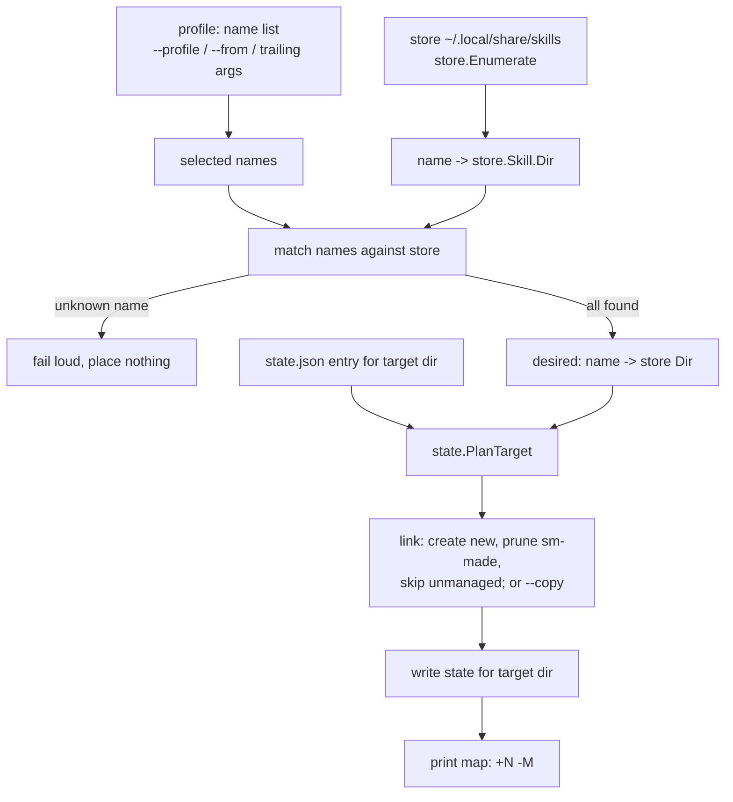

# `sm map`: store-sourced, profile-selected skill projection — DESIGN

Status: approved, pre-implementation. Date: 2026-11-13.
Base: the store-model `sm`/`ms` on `origin/main` (`0476e1b`).

## Intent and why

`sm`/`ms` has one source of truth: the agent-neutral **store** at
`~/.local/share/skills/` (`$XDG_DATA_HOME/skills`). `ms` fills the store; the
store is the "one true ring." Today `sm sync` fans the **whole** store out into
**every** enabled agent directory.

What is missing is the ability to project a **named subset** of the store into
**one folder the caller chooses**. The driving case is a one-shot sub-agent run
(e.g. `../agentdev`) that should see only the handful of skills relevant to its
task, not the entire library — but the same operation is just as useful for
pointing a hand-picked set at a real agent directory. The caller names the
skills (in a file, or on the command line) and names the target folder; `sm`
symlinks that subset from the store into that folder and keeps it reconciled.

This is the generalization of the earlier `sm map` idea, now sourced from the
store instead of from git `sources`.

## Goals

- A new `sm map` verb: **profile (a list of skill names) + target folder →
  symlinks from the store into that folder**, reconciled and safe to re-run.
- Three ways to name the subset (all resolve to the same list of skill names):
  1. `--profile <name>` — a named profile at
     `~/.config/skills-mapper/profiles/<name>.toml`.
  2. `--from <path>` — any profile file by path.
  3. trailing `skill-name ...` — an ad-hoc list on the command line.
- The target folder is **exactly the folder the caller names**. It may be an
  ephemeral sub-agent directory or a real agent directory; `sm map` does not
  care which and does not interpret it.
- Reconcile on re-run: add newly-selected links, remove only links `sm`
  previously recorded for that target that are no longer selected, never touch
  anything `sm` did not create.
- `--dry-run` previews the plan (`+N -M`) and touches nothing.
- `--copy` writes real copies instead of symlinks, for a sandbox/container
  target a symlink cannot reach into (reusing the existing copy machinery).

## Non-goals (this design)

- **No change to `ms`** or to how the store is filled. `sm map` only reads the
  store.
- **`sm sync` is unchanged and stays.** Whole-store → every enabled agent
  remains the everyday "set up my real agents" verb. `sm map` is additive.
- **No git `sources`, no `skills.toml`, no `add`/`remove`/`list`.** Getting
  skills *into* the store is `ms`'s job; `sm` never fetches. (These never
  existed on this store-model base; they are explicitly not being brought in.)
- **The Vercel 81-agent roster realignment is out of scope here.** `sm map`
  targets an explicit folder, so it needs no agent roster. Folding the Vercel
  roster into the store model's `agents` registry is a separate, later decision.

## Anti-goals (would make this a failure)

- `sm map` clobbering a real file or a hand-placed skill in the target folder.
- `sm map` failing a whole run because an *unrelated* store entry is
  non-conforming. Only the **named** skills must resolve.
- A silent wrong subset: an unknown skill name must fail loud, not be skipped.

## The decided how

### Command

```
sm map [--profile <name> | --from <path>] [--dry-run] [--copy] <target-dir> [skill-name ...]
```

- `--profile` and `--from` are mutually exclusive; giving both is a usage error.
- A selection source is required: at least one of `--profile`, `--from`, or one
  trailing skill name. (A target folder with no skills named is a usage error —
  it would mean "remove everything," which the caller must not trigger by
  omission.)
- Flags are position-tolerant (they may appear after the target folder), so the
  documented `sm map --from ./run.toml ./run --dry-run` form works. This verb is
  the first with positionals: the shared `parseFlags` helper rejects positionals
  and stdlib `flag` stops at the first one, so `runMap` hand-rolls argument
  splitting (flags vs. target vs. trailing names) instead of reusing `parseFlags`.

### Profile file

Hand-edited TOML, a single list of clean skill names:

```toml
skills = ["rebuild", "check-linters"]
```

Named profiles live at `~/.config/skills-mapper/profiles/<name>.toml` (honoring
`XDG_CONFIG_HOME`). `--from` takes any path. The ad-hoc trailing list is the
same thing without a file.

### Resolution against the store

1. `storeDir := store.DefaultPath()` (or `--store DIR` override, mirroring the
   other verbs); refuse a world-writable store (`store.RequireNotWorldWritable`).
2. `listing := store.Enumerate(storeDir)` — the conforming skills, each a
   `store.Skill{Name, Dir, ...}`.
3. For each **named** skill: look it up by `Name` in the listing.
   - Found → select `store.Skill.Dir` as the link source.
   - **Not found** → collect it; after checking all names, fail loud listing
     every unknown name, and place nothing.
   - Because the store holds **one directory per skill, names are unique** —
     there is no cross-source ambiguity to resolve (unlike the git-sources
     model). A name is either present once or absent.
4. A store entry that is non-conforming (`listing.Unusable`) is treated as
   *not a usable skill*: if a **named** skill is Unusable, that is a fail-loud
   error (it was asked for and cannot be placed); unrelated Unusable entries are
   ignored.

### Placement, state, reconcile (reuse existing machinery)

- The target is normalized to an absolute, clean path first (`pathutil.Abs`,
  then `pathutil.ResolveExisting` as `sync` does); `state` refuses a key that is
  not absolute-and-clean, so `./run` cannot be used raw.
- Desired set = `{name → selected store.Skill}` for the selected names — carry
  the whole `store.Skill` (its `Dir`, plus `Identity`/`ManifestIdentity`) so
  `--copy` can build a `link.StorePin`, not just the `Dir` string.
- Recorded set = the state entry for this absolute target dir.
- `state.PlanTarget(desired, recorded, inspect)` yields the full plan
  (add/remove/keep plus `Repoint`/`Unmanaged`/`Lost`). `Repoint` is inert here
  (a skill's store path is deterministically `storeDir/name`), but `Unmanaged`
  and `Lost` are reported and skipped — reuse the `planLinks`/`warnPlan` shape
  from `runSync`.
- Take the state lock across load→save, exactly as `runSync` and `ms` do
  (`state.Lock`), skipping it only under `--dry-run`.
- Apply with the existing `link` package: `link.Create` (or `CreateCopy`/
  `RefreshCopy` under `--copy`), `link.RemoveIfTarget` for prunes,
  `link.CheckTargetDir` for the target-dir safety checks. Only `sm`-recorded
  links are ever removed; a pre-existing unmanaged entry is reported and
  skipped, never overwritten.
- Persist via `state.Load` → update this target's entry → `state.Save`. State is
  already keyed by absolute target path, so a run target and a real agent dir
  coexist without interfering.
- Print `map: +N -M` (and under `--dry-run`, the same line with nothing written).
- No empty-store guard (`--allow-empty`) is needed: `map` requires ≥1 named
  selection, and a named skill missing from an empty store fails loud as
  "unknown" before anything is removed.

### Flow



### Lifecycle and `clean --orphans`

A `map` target is never in `agents.toml`, so `sm clean --orphans` (which sweeps
every recorded state target no configured agent maps —
`cleanOrphans`/`classifyUnmapped` in `internal/cli/clean.go`) would otherwise
tear down an in-flight run dir. Decision: **`map` targets are exempt.**

- `state.Target` gains a `Mapped bool` field (`json:"mapped,omitempty"`, so
  state written by sync/copy-only setups stays byte-identical). `runMap` sets it
  on the target it writes.
- `classifyUnmapped` classifies a `Mapped` target as a new kind that
  `cleanOrphans` leaves alone (reported, not removed), the way a
  `--agent-home`-provisioned target is left alone today.

Teardown of a `map` target is therefore: re-run `sm map` with a smaller profile
(reconcile shrinks it), or delete the directory. No explicit unmap verb in v1.

## What is left to the builder

- Exact package layout for the new logic. Suggested: a small `internal/mapsel`
  (match a name list against a `store.Listing` → the selected `store.Skill`s,
  with a fail-loud error carrying all unknown names) plus `internal/profile`
  (parse the TOML `skills` list; locate named profiles), ported and adapted from
  the equivalent work on the sources branch (`bd5cb0b`). The `runMap` command
  wires store + mapsel + link + state, following the existing command registry
  and `runSync` as the pattern.
- Error message wording, usage text, and the help/registry entry, matching the
  style already in `internal/cli`.
- Whether `runMap` shares helpers with `runSync` (both resolve the store and a
  target and reconcile) or stays standalone for clarity — builder's call.

## Decisions (resolved 2026-11-13)

All four settled with the author; this design reflects them as decided, not open.

1. **Target folder is literal.** `sm map ./run` writes links directly into
   `./run`. No `.agents/skills` auto-append; the caller passes the exact folder
   (e.g. `./run/.agents/skills`) when they want that.
2. **`sm sync` stays**, unchanged (whole store → every enabled agent). `map` is
   additive.
3. **Vercel 81-agent roster is a separate, later change** — out of scope here.
4. **`map` targets are exempt from `clean --orphans`** (via the `Mapped` marker
   above), and there is **no explicit unmap verb in v1**: reconcile with a
   smaller profile, or delete the directory.
