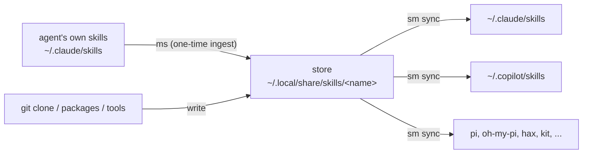

# Using skills-mapper (`sm` and `ms`)

## Overview

AI coding agents share a skill *format* (a directory holding a `SKILL.md`) but
each keeps skills in its own folder (Claude Code `~/.claude/skills`, Copilot
`~/.copilot/skills`, ...). **skills-mapper** keeps one agent-neutral **store**
and mirrors it into every agent's folder.

- **`sm`** (skills-mapper) fans the store *out* to the agents.
- **`ms`** (the reverse) ingests an agent's existing skills *into* the store.



The normal direction of work is: edit skills **in the store**, then `sm sync`.
`ms` is only the on-ramp that seeds the store from skills you already have.

**Linux is the only tested platform** (macOS builds, untested; Windows
unsupported). Build with `make build` (produces `./bin/sm` and `./bin/ms`);
`make install` puts them in `~/.local/bin`. Never run `go build` directly.

## Core concepts

- **Skill**: a directory containing `SKILL.md`, which starts with YAML
  frontmatter declaring a `name` (usually a `description` too), then markdown.
  Files beside `SKILL.md` belong to the skill.
- **Store**: one flat directory, `$XDG_DATA_HOME/skills` (default
  `~/.local/share/skills`), one subdirectory per skill. **The directory name
  must match `^[a-z0-9]([a-z0-9-]*[a-z0-9])?$` and must equal the frontmatter
  `name`**, or `sm` skips the entry with a warning. Entries beginning with `.`
  (e.g. `.git`) are ignored, so a git checkout works as a store.
- **Agent**: a `name = "dir"` entry in `agents.toml`. `sm` mirrors the store
  into each agent's `dir`.
- **State**: `sm` records exactly which links/copies it created, and only ever
  touches entries whose identity still matches that record. Anything you placed
  by hand is left alone.
- **Modes**: *symlink* (default) or *copy* (`--copy`). See
  [Symlink vs copy mode](#symlink-vs-copy-mode).

## Quick reference — `sm`

`sm [-v] <command> [flags]` (`-v`/`--verbose` is global, accepted anywhere).

| Command | Does | Flags |
| --- | --- | --- |
| `sm sync` | Link (or copy) every store skill into each agent dir; reconcile removals | `--dry-run`, `--copy`, `--store DIR`, `--agent-home DIR`, `--allow-empty` |
| `sm init` | Write a starter `agents.toml` (every known agent commented out). Refuses to overwrite | (none) |
| `sm status` | Read-only report per agent: `owned/missing/unmanaged/dangling` | `--store DIR`, `--agent-home DIR` |
| `sm clean` | Remove every `sm`-created link/copy (identity-checked) | `--agent NAME`, `--agent-home DIR`, `--orphans` |
| `sm probe` | Detect installed agents, append confirmed ones to `agents.toml` | `--yes`, `--dry-run` |
| `sm install-skill` | Install the carried `using-skills-mapper` skill into the store | `-f`, `--force` |
| `sm print-skill` | Write the carried skill's `SKILL.md` to stdout (nothing installed) | (none) |
| `sm -h` / `--help` / `help` | Usage | |

Run `sm <command> -h` for per-command flag help. No subcommand takes positional
arguments; a stray positional is a usage error (exit 2), so `sm sync now` is
refused rather than silently dropping later flags.

Exit codes: `0` ok, `1` error, `2` usage error, `3` `install-skill` refused
(target exists and differs; use `--force`).

## Quick reference — `ms`

```
ms [flags] [--] <source> [dest]
```

- `<source>`: a proprietary agent skills folder (e.g. `~/.claude/skills`).
- `[dest]`: destination store (default: the canonical store).
- Flags may appear **before or after** the positionals. `--` ends flag parsing;
  everything after it is a path even if it starts with `-`.

| Flag | Does |
| --- | --- |
| `--format NAME` | Source tree format (default `claude-code`) |
| `--force` | Overwrite skills already present in the destination |
| `--dry-run` | Report what would be written; write nothing |
| `-v` / `--verbose` | Print one line per skill |
| `--follow-symlinks` | Ingest skills reached through symlinks (incl. outside the source tree) |
| `-h` / `--help` | Usage |

`ms` also accepts the two self-skill subcommands as its first argument:
`ms install-skill [-f|--force]` and `ms print-skill` behave exactly like the
`sm` ones below.

`ms` **copies; it never moves or deletes your originals.** Output ends with
`ms: +<written> (skipped <n>)`. A per-skill failure is reported and the rest
still ingest (exit `1` if any failed).

## The carried skill: `install-skill` and `print-skill`

Both binaries **embed this very skill inside the executable**. Whoever has a
binary has the documentation for it, with nothing else to fetch:

- **`<tool> install-skill`** writes the carried skill into the store as
  `~/.local/share/skills/using-skills-mapper`, then `sm sync` mirrors it into
  each agent. It needs no config, no network, no agents set up — it works on a
  freshly built binary.
  - Refuses (exit `3`) if a *different* directory of that name already exists;
    pass `-f`/`--force` to replace it.
  - If the existing directory is already identical, it is a success no-op.
  - The write is crash-safe (staged beside the store, renamed into place) and
    never leaves a partial skill directory behind.
- **`<tool> print-skill`** writes the carried `SKILL.md` verbatim to stdout and
  nothing else, so an agent can read it straight into context without installing
  anything. `<tool> print-skill > SKILL.md` captures it exactly.

```sh
sm print-skill | less          # read the skill without touching disk
sm install-skill               # install it into the store (or: ms install-skill)
sm sync                        # mirror the store into each agent's folder
```

`sm install-skill` and `ms install-skill` install the same skill; run either
one. Prefer this over copying files by hand — it always writes the correct
store entry name (`using-skills-mapper`) regardless of where the binary lives.

## Typical workflows

**First-time setup** (adopt Claude Code's existing skills, then mirror to all):

```sh
ms ~/.claude/skills                 # 1. copy existing skills into the store
mv ~/.claude/skills ~/claude-skills-backup  # 2. move originals aside (see below)
sm probe                            # 3. detect agents -> agents.toml (y/N each)
sm sync --dry-run                   # 4. preview
sm sync                             # 5. apply
sm status                           # 6. verify: all missing/unmanaged/dangling = 0
```

Step 2 matters: `ms` only *copies*. If the real directories stay in
`~/.claude/skills`, `sm` refuses to replace them and every sync warns
`... exists and is not managed by sm; skipping`. Moving them aside lets `sm
sync` recreate the folder as links. **Before moving**, read the `ms` warnings —
a skill `ms` skipped (bad frontmatter, a symlinked skill without
`--follow-symlinks`) is not in the store and would then live only in the backup.
Keep the backup *outside* `~/.claude` so a later `ms ~/.claude` does not re-ingest it.

**Day to day** (every routine ends with `sm sync`; it is always safe to re-run):

| You want to | Do this |
| --- | --- |
| Add/edit a skill | Edit `~/.local/share/skills/<name>/SKILL.md` (dir name == frontmatter `name`), then `sm sync`. In symlink mode an *edit* to an existing skill is live immediately; a *new* skill needs the sync. |
| Pull from a git-backed store | `git -C ~/.local/share/skills pull`, then `sm sync` (deletions are unlinked). |
| Remove a skill | Delete its store dir, then `sm sync`. |
| Start using another agent | `sm probe` (or add a line to `agents.toml`), then `sm sync`. |
| Stop using an agent | Remove its line from `agents.toml`, then `sm clean --orphans`. |
| Adopt skills an agent made itself | `ms <agent skills folder>`, then `sm sync`. |
| Undo everything | `sm clean`. |

> `ms ~/.claude/skills` takes only personal skills. `ms ~/.claude` walks the
> whole tree **including `~/.claude/plugins`**, pulling in plugin skills (which
> Claude Code then sees twice). `ms` prints a `note:` line when it wrote plugin
> skills — review third-party skills before enabling them.

## agents.toml

Location: `$XDG_CONFIG_HOME/skills-mapper/agents.toml` (default
`~/.config/skills-mapper/agents.toml`). Format:

```toml
[agents]
claude-code = "/home/you/.claude/skills"
copilot     = "~/.copilot/skills"
```

- Values may use a leading `~` and `$VAR`; the result must be absolute. An
  **undefined or empty** `$VAR` is a hard error (never silently `/skills`).
- Unknown keys or a wrong-shaped `agents` value are rejected loudly.
- A dir that is `$HOME` or an ancestor of it is refused (too broad to manage).
- Two agents resolving to the same real dir collapse to one (warned).

Well-known agents `sm probe` / `sm init` know about:

| Name | Default dir | Binary |
| --- | --- | --- |
| `claude-code` | `~/.claude/skills` | `claude` |
| `copilot` | `~/.copilot/skills` | `copilot` |
| `hax` | `~/.config/hax/skills` | `hax` |
| `pi` | `~/.pi-go/skills` | `pi` |
| `oh-my-pi` | `~/.config/agents/skills` | `omp` |
| `kit` | `~/.config/kit/skills` | `kit` |

Any other agent works too — add it to `agents.toml` by hand.

## `sm status` output

```
store: 2 skills (~/.local/share/skills)
claude-code    owned=2 missing=0 unmanaged=0 dangling=0  ~/.claude/skills
```

| Count | Meaning | Fix |
| --- | --- | --- |
| `owned` | `sm`'s own link/copy, intact | — |
| `missing` | Store skill not present in the agent dir | `sm sync` |
| `unmanaged` | A real dir / foreign entry at that name; `sm` won't touch it | Move it aside, then `sm sync` |
| `dangling` | Recorded entry whose store skill is gone, or an `sm` link whose target moved | `sm sync` repoints/removes |

A healthy agent shows `missing=0 unmanaged=0 dangling=0`. `sm status` with no
`--agent-home` also reports **orphaned / aliased / provisioned / unclassifiable**
state targets (directories in state that no configured agent maps).

## Symlink vs copy mode

- **Symlink (default)**: `<agent>/<name>` → `store/<name>`. Store edits are seen
  instantly. Smallest, fastest, preferred.
- **Copy (`--copy`)**: real copied directories, for sandboxed/container homes
  where symlinks don't work. Each copy carries a `.sm-copy` provenance marker;
  **every sync refreshes** owned copies so they track store edits. A dir is a
  mode: switch one by running `sm clean` on it first, then sync in the other mode.

## Advanced flags

- `--store DIR` (`sync`, `status`): use a different store than the default.
- `--agent-home DIR` (`sync`, `status`, `clean`): re-root every agent dir from
  `$HOME` into `DIR` (e.g. `~/.claude/skills` → `DIR/.claude/skills`). Used to
  provision a skills layout for another process launched with `DIR` as its
  `HOME` (containers). Agent dirs must be under `$HOME`. `clean --agent-home`
  removes a provisioned layout; `clean --orphans` leaves provisioned targets alone.
- `--allow-empty` (`sync`): permit a run where the store has **zero** skills to
  prune every recorded entry. Refused by default, because an unmounted volume or
  a mistyped `--store` looks exactly like an empty store and would wipe the whole
  setup.

## Safety model (why a run may refuse)

`sm`/`ms` are deliberately strict; a refusal is protecting the setup:

- **World-writable store** → refused (someone could plant/swap a skill).
- **Empty store** that would prune recorded entries → refused unless `--allow-empty`.
- **Agent dir == `$HOME` or an ancestor**, or **overlapping the store** → refused.
- **World-writable target dir** when adding links/copies → that agent is skipped.
- **Removals are identity-checked**: only a link whose `readlink` still equals the
  recorded target, or a copy whose `.sm-copy` marker names the recorded store
  path, is ever removed. A link you re-pointed or a real dir you created is left
  in place and its stale record dropped.
- `ms` never moves or deletes source skills, and refuses a destination that
  overlaps the source.
- `install-skill` refuses to overwrite a differing skill without `--force`, and
  never leaves a partial skill directory in the store.

## Files and locations

`$XDG_CONFIG_HOME` defaults to `~/.config`, `$XDG_DATA_HOME` to `~/.local/share`
(a relative value is ignored).

| Path | What |
| --- | --- |
| `$XDG_DATA_HOME/skills/` | The store |
| `$XDG_CONFIG_HOME/skills-mapper/agents.toml` | Agents to mirror into |
| `$XDG_DATA_HOME/skills-mapper/state.json` | `sm`'s record of links/copies it owns (`0600`) |
| `$XDG_DATA_HOME/skills-mapper/state.json.lock` | Lock shared by `sm sync`, `sm clean`, `ms` |
| `$XDG_DATA_HOME/skills-mapper/ingest-log.json` | `ms` ingest ledger (`0600`) |
| `<agent dir>/<name>/.sm-copy` | Copy-mode provenance marker |
| `<dir>/.sm-stage-*`, `<dir>/.sm-old-*` | Temp staging/set-aside during copy/replace |

The `skills-mapper` data dir is created `0700`; `sm sync`/`sm clean` tighten an
existing one you own to `0700`.

## Troubleshooting

| Symptom | Cause / fix |
| --- | --- |
| `... exists and is not managed by sm; skipping` | A real dir sits at that name (ingested originals left in place). Move it aside, `sm sync`. |
| `... is managed by sm in copy mode; run 'sm clean' ...` | Name owned in the other mode. `sm clean` that dir, then sync in the mode you want. |
| `store ... has no skills, but sm recorded entries ...` | Store looks empty (unmounted? wrong `--store`?). Fix it, or pass `--allow-empty` if truly empty. |
| `undefined or empty environment variable $X` | An `agents.toml` value used an unset `$VAR`. |
| Store skill skipped as `illegal skill name` / `name mismatch` | Dir name must match the regex **and** equal the frontmatter `name`. |
| `no agents enabled in agents.toml` | Nothing is uncommented in `agents.toml`; run `sm probe` or edit it. |
| `install-skill` exits `3` | A different `using-skills-mapper` already in the store; re-run with `--force` to replace it. |
| Something looks off | Start with `sm status`, then `sm sync --dry-run`. |

## Installing this skill from a source folder

Besides `install-skill` (which installs the copy embedded in the binary), the
skill can be ingested from a source directory with `ms`. If you have a `skill/`
folder containing this skill, `ms ./skill` copies it into the store as
`~/.local/share/skills/using-skills-mapper` (ms names the store entry from the
frontmatter `name`, not from the source directory, so no renaming is needed),
then `sm sync` mirrors it to the agents. Preview with `ms --dry-run -v ./skill`.
Do **not** install it with a plain `cp` of a differently named directory: `sm`
skips a store entry whose directory name differs from the frontmatter `name`.
